# فصل ۱ — معرفی موجودیار

> افزونه‌ای که حلقهٔ «ناموجود شد، مشتری رفت» را می‌بندد: مشتری شماره یا ایمیل می‌گذارد و به‌محض بازگشت موجودی، خودکار خبر می‌گیرد.

*این فصل چه می‌کند، چه نمی‌کند، برای چه فروشگاهی مناسب است و کجا باید سراغ چیز دیگری بروید.*

موجودیار یک افزونهٔ وردپرس است که برای ووکامرس نوشته شده و یک کار مشخص انجام می‌دهد: وقتی کالایی تمام می‌شود، به مشتری اجازه می‌دهد شمارهٔ موبایل یا ایمیل خود را بگذارد و به‌محض بازگشت موجودی، از طریق پیامک یا ایمیل خبر بگیرد.

این فصل می‌گوید افزونه چه مشکلی را حل می‌کند، چطور کار می‌کند، چه قابلیت‌هایی دارد و — مهم‌تر از همه — چه کارهایی را عمداً انجام نمی‌دهد.

## مسئله‌ای که موجودیار حل می‌کند

در فروشگاه اینترنتی، مشتری‌ای که با پیام «ناموجود» روبه‌رو می‌شود معمولاً صفحه را می‌بندد و برنمی‌گردد. او محصول را می‌خواست، اما کسی به او خبر نمی‌دهد که دوباره رسیده است. سه راه‌حل رایج، هر سه ناقص‌اند:

| راه‌حل رایج | اشکال |
| --- | --- |
| تماس تلفنی با مشتری | وقت‌گیر است، به ثبت شمارهٔ همهٔ مشتریان بستگی دارد و برای یک فروشگاه کوچک مقیاس‌پذیر نیست. |
| یادداشت دستی در دفتر یا فایل اکسل | گم می‌شود، بین همکاران همگام نیست و به‌خاطر سپردن «چه کسی برای چه کالایی منتظر است» ممکن نیست. |
| افزونه‌های اعلان موجودی موجود در بازار | بسیاری در همهٔ صفحات سایت فایل استایل و اسکریپت بار می‌کنند، به سرور سازنده وابسته‌اند یا فقط ایمیل دارند. |

موجودیار این حلقه را خودکار می‌کند: مشتری ثبت می‌کند، افزونه وضعیت موجودی را می‌پاید، و لحظه‌ای که کالا برمی‌گردد پیام می‌فرستد.

## نحوهٔ عملکرد کلی

مسیر یک درخواست، از ثبت تا پیام، شش گام دارد. این نقشه را به یاد بسپارید؛ بیشتر عیب‌یابی‌های فصل ۱۲ به همین شش گام برمی‌گردد.

**گام ۱ — نمایش فرم** روی صفحهٔ محصولی که «در انبار نیست»، فرم «خبرم کن» نمایش داده می‌شود؛ یا با شورت‌کد در هر جای دیگری که خودتان تعیین کنید.

**گام ۲ — ثبت درخواست** مشتری نام، شمارهٔ موبایل یا ایمیل را وارد می‌کند. افزونه داده را اعتبارسنجی می‌کند، تکراری‌ها را حذف می‌کند و ردیف را در جدول لیست انتظار ذخیره می‌کند.

**گام ۳ — پایش موجودی** افزونه دو مسیر دارد: هوک‌های خود ووکامرس (تغییر موجودی از پنل) و یک پایش تطبیقی زمان‌بندی‌شده که تغییرهای بیرون از ووکامرس (اکسل، نرم‌افزار انبار، SQL) را هم می‌بیند.

**گام ۴ — ساخت پیام** وقتی گذار «ناموجود ← موجود» تشخیص داده شد، برای منتظران واجد شرایط یک ردیف در صف ارسال ساخته می‌شود. متن پیام از قالب شما ساخته می‌شود.

**گام ۵ — ارسال پس‌زمینه** صف، پیام‌ها را با محدودیت نرخ، بازهٔ مجاز ارسال و تلاش مجدد پلکانی، از طریق درگاه پیامک یا wp_mail می‌فرستد.

**گام ۶ — ثبت نتیجه** هر موفقیت یا خطا در گزارش رویدادها با یک جملهٔ فارسی ثبت می‌شود تا بدانید چه شد و اگر کاری لازم است، چه کاری.

**نکته.** گام ۴ و ۵ از هم جدا هستند. «پیام در صف قرار گرفت» به معنی «پیام تحویل شد» نیست. اگر صف اجرا نشود (مثلاً WP-Cron روی هاست شما کار نکند) پیام در صف می‌ماند و ارسال نمی‌شود. راه تشخیص در فصل ۱۲ آمده است.

## قابلیت‌های اصلی

| قابلیت | چه می‌کند | فصل |
| --- | --- | --- |
| فرم خودکار «خبرم کن» | روی صفحهٔ محصول ناموجود، نزدیک پیام ناموجود نمایش داده می‌شود. | ۳ |
| شورت‌کد و انتخاب‌گر تنوع | برای تعیین محل فرم و پوشش محصولات متغیر. | ۳ |
| کانال پیامک و ایمیل | چهار درگاه پیامک ایرانی و یک درگاه عمومی REST، به‌همراه ایمیل وردپرس. | ۵ |
| الگوی پیامک خدماتی | ارسال با شناسهٔ الگو (bodyId) برای خطوطی که متن آزاد نمی‌پذیرند. | ۶ |
| مدیریت لیست انتظار | جست‌وجو، فیلتر، تغییر وضعیت، عملیات گروهی و خروجی CSV. | ۷ |
| پیگیری تلفنی | ثبت مرحله‌به‌مرحلهٔ تماس‌ها با نتیجه، یادداشت و خاتمه. | ۸ |
| داشبورد و آمار | شمارش وضعیت‌ها، نمودار روزانه، پرتقاضاترین محصول‌ها و ثبت‌های ردشده. | ۹ |
| ابزارهای تشخیصی | پایش فوری، پردازش صف، آزمون ارسال، وضعیت جدول‌ها و لاگ. | ۱۰ |
| حریم خصوصی | ذخیره‌نشدن IP خام، پوشاندن شماره و ایمیل، حذف اختیاری داده هنگام حذف افزونه. | ۱۱ |

## محدودهٔ عملکرد: چه چیزی هست و چه چیزی نیست

این بخش را جدی بگیرید. بیشتر نارضایتی‌ها از افزونه‌های مشابه، از انتظاری می‌آید که محصول آن را وعده نداده است.

### آنچه موجودیار انجام می‌دهد

- نمایش فرم «خبرم کن» فقط برای محصول یا تنوعی که **واقعاً ناموجود** و قابل نمایش است؛ برای محصول موجود، فرم ساخته نمی‌شود.
- ارسال پیام از طریق کانالی که خودتان تنظیم می‌کنید؛ افزونه هیچ سرور واسط ندارد و هیچ داده‌ای به سازنده نمی‌فرستد.
- اجرا روی PHP ۷٫۴ تا ۸٫۳ بدون نیاز به Composer، npm، IonCube یا کلید لایسنس.
- بارگذاری فایل‌های استایل و اسکریپت فقط در صفحه‌ای که فرم دارد (بارگذاری شرطی).

### آنچه موجودیار انجام نمی‌دهد

| قابلیت | وضعیت در این نسخه |
| --- | --- |
| اعلان وضعیت سفارش | وجود ندارد؛ این کار افزونهٔ سفارش است، نه لیست انتظار. |
| واتس‌اپ، تلگرام، اپ موبایل | وجود ندارد. |
| تماس تلفنی خودکار یا ربات صوتی | وجود ندارد؛ بخش «پیگیری تلفنی» فقط ثبت دستی تماس است. |
| نوبت‌دهی یا وقت‌دهی | وجود ندارد؛ لیست انتظار یعنی «خبرم کن»، نه رزرو نوبت. |
| باشگاه مشتریان، امتیاز، کش‌بک | وجود ندارد. |
| بیش از چهار کانال پیامک | سه درگاه اختصاصی + یک درگاه عمومی REST، بیشتر نه. |
| رابط چندزبانه | متن پنل مستقیماً فارسی است؛ ترجمهٔ کامل رابط در این نسخه ارائه نشده. |
| نمایش خودکار فرم در سبد خرید و تسویه‌حساب | وجود ندارد و شورت‌کد هم نباید داخل فرم دیگری قرار گیرد. |

## چه کسی می‌تواند از آن استفاده کند

موجودیار برای فروشگاه‌های فارسی‌زبان ایرانی طراحی شده است. دلیلش دو چیز است: درگاه‌های پیامکی که پشتیبانی می‌شوند ایرانی‌اند، و رابط کاربری از ابتدا فارسی و راست‌چین با تاریخ شمسی و ارقام فارسی نوشته شده است.

**محدودیت واقعی.** دسترسی به بخش‌های مدیریتی افزونه به قابلیت `mojoodyar_manage` بسته است. این قابلیت هنگام فعال‌سازی به نقش‌های «مدیر سایت» و «مدیر فروشگاه» ووکامرس داده می‌شود. اگر کاربری منوی موجودیار را نمی‌بیند، مشکل از افزونه نیست؛ نقش او این قابلیت را ندارد.

# فصل ۲ — پیش‌نیازها و نصب

> پیش از نصب باید بدانید چه نسخه‌هایی لازم است، چه چیزی روی سرور باید فعال باشد و اگر نصب نیمه‌کاره ماند چه کنید.

*نصب از فایل ZIP، فعال‌سازی، بررسی پس از نصب و رفتار هنگام غیرفعال‌سازی یا حذف.*

نصب موجودیار ساده است، اما چند پیش‌نیاز دارد که اگر رعایت نشوند افزونه فعال می‌شود ولی کار نمی‌کند. این فصل ابتدا پیش‌نیازها را می‌گوید، بعد نصب را گام‌به‌گام توضیح می‌دهد و در پایان یک فهرست کنترل کوتاه می‌آورد.

## پیش‌نیازها

| مورد | حداقل لازم | توضیح |
| --- | --- | --- |
| وردپرس | ۶٫۴ | نسخهٔ دقیق آزمون‌شده ۶٫۴٫۵ است؛ نسخه‌های پایین‌تر پیشنهاد نمی‌شوند. |
| ووکامرس | ۹٫۰ | بدون ووکامرس، فرم و تشخیص موجودی کار نمی‌کند. |
| PHP | ۷٫۴ | کد با PHP ۷٫۴ تا ۸٫۳ سازگار است. PHP ۸٫۴ در این نسخه آزمون نشده است. |
| پایگاه‌داده | MySQL / MariaDB با موتور InnoDB | پنج جدول با پیشوند mjy ساخته می‌شود. |
| دسترسی | مدیر سایت یا مدیر فروشگاه | برای دیدن منو و تنظیمات. |
| جاوااسکریپت کاربر | فعال در مرورگر مشتری | ثبت فرم بدون جاوااسکریپت انجام نمی‌شود. |

**هشدار.** اگر ووکامرس نصب و فعال نباشد، موجودیار فعال می‌شود ولی فرم روی سایت نمایش داده نمی‌شود و در پیشخوان یک هشدار زرد می‌بینید. این خطا نیست؛ افزونه برای ووکامرس ساخته شده است. اول ووکامرس را فعال کنید.

## نصب از فایل ZIP

**گام ۱ — فایل بسته را آماده کنید** فایل نصب افزونه را از بستهٔ خریداری‌شده بردارید. اگر فایل ZIP را از حالت فشرده خارج کرده‌اید، دوباره آن را ZIP کنید؛ وردپرس فایل **ZIP** می‌خواهد، نه پوشهٔ باز.

**گام ۲ — به صفحهٔ بارگذاری بروید** در پیشخوان وردپرس: **افزونه‌ها** ← **افزودن افزونه** ← دکمهٔ **بارگذاری افزونه**.

**گام ۳ — فایل را انتخاب و نصب کنید** دکمهٔ **انتخاب فایل** را بزنید، فایل ZIP را انتخاب کنید، سپس **هم‌اکنون نصب کن** را بزنید.

**گام ۴ — افزونه را فعال کنید** پس از پیام موفقیت، دکمهٔ **فعال کردن افزونه** را بزنید. با فعال‌سازی، جدول‌های پایگاه‌داده ساخته می‌شوند، تنظیمات پیش‌فرض نوشته می‌شوند و سه زمان‌بندی WP-Cron ثبت می‌گردد.

**گام ۵ — منو را ببینید** در نوار کناری پیشخوان، منوی **موجودیار** با آیکون زنگ اضافه می‌شود. اگر آن را نمی‌بینید، به بخش «مشکلات احتمالی نصب» در همین فصل بروید.

**نکته.** افزونه بدون کلید لایسنس، بدون اتصال به سرور سازنده و بدون نصب وابستگی اضافه فعال می‌شود. ایمیل از همان ابتدا روشن است، پس فرم با کانال ایمیل بدون هیچ تنظیمی کار می‌کند. پیامک به‌طور پیش‌فرض خاموش است و تا وقتی درگاه را تنظیم نکنید فرستاده نمی‌شود.

## پس از فعال‌سازی: بررسی صحت نصب

سه چیز را بررسی کنید. اگر هر سه درست بودند، نصب سالم است.

| بررسی | چطور | نتیجهٔ درست |
| --- | --- | --- |
| ۱. جدول‌ها ساخته شده‌اند | موجودیار ← ابزارها ← بخش «وضعیت جدول‌ها» | پنج جدول با موتور InnoDB و برچسب «درست». |
| ۲. زمان‌بندی ثبت شده است | همان صفحه؛ عبارت «آخرین پایش» | یا زمان دارد، یا «هنوز اجرا نشده است» که طبیعی است. |
| ۳. مسیر ارسال ایمیل | موجودیار ← ابزارها ← «ارسال ایمیل آزمایشی» | پیام موفقیت یا متن خطای واقعی سرور. |

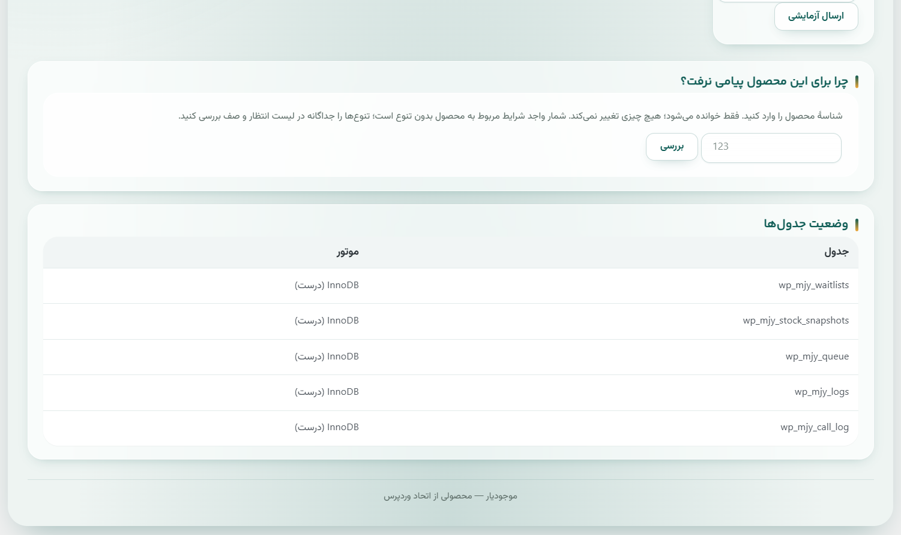

*شکل ۲‑۱ — بخش «وضعیت جدول‌ها» در صفحهٔ ابزارها. هر ردیف نام جدول، موتور و نتیجهٔ بررسی را نشان می‌دهد.*

**پیشنهاد.** اولین اجرای پایش موجودی، فقط «تصویر» وضعیت فعلی را می‌گیرد و هیچ اعلانی نمی‌فرستد. این کار عمدی است تا کالاهایی که پیش از نصب شما موجود بوده‌اند، به اشتباه «تازه موجود شده» حساب نشوند.

## مشکلات احتمالی نصب

| نشانه | علت محتمل | راه‌حل |
| --- | --- | --- |
| پیام «افزونه نصب نشد: فایل بارگذاری‌شده از حداکثر حجم مجاز بیشتر است» | محدودیت upload_max_filesize هاست | حجم فایل را از هاستینگ بالا ببرید یا بسته را با FTP در پوشهٔ wp-content/plugins بارگذاری و از همان‌جا فعال کنید. |
| منوی موجودیار در پیشخوان نیست | نقش کاربری قابلیت لازم را ندارد، یا افزونه فعال نشده است | با حساب مدیر اصلی وارد شوید؛ اگر باز هم نبود، افزونه را غیرفعال و دوباره فعال کنید. |
| هشدار «ووکامرس نصب نشده است» | ووکامرس غیرفعال یا حذف شده است | ووکامرس را نصب و فعال کنید؛ فرم بدون آن نمایش داده نمی‌شود. |
| صفحهٔ ابزارها می‌گوید ساختار پایگاه‌داده کامل نیست | ساخت جدول‌ها نیمه‌کاره مانده است | از داده‌ها پشتیبان بگیرید، افزونه را غیرفعال و دوباره فعال کنید تا ساخت جدول‌ها تکرار شود. |
| پیام «موتور جدول InnoDB نیست» | هاست موتور پیش‌فرض دیگری دارد | با ابزار پایگاه‌داده جدول را به InnoDB تغییر دهید؛ جزئیات در فصل ۱۲. |
| پس از به‌روزرسانی، صف پردازش نمی‌شود | نسخهٔ کد و نسخهٔ پایگاه‌داده یکی نیست | هشدار «به‌روزرسانی نیمه‌کاره» را ببندید: صفحهٔ افزونه‌ها را باز کنید و پیام را دنبال کنید؛ اگر رفع نشد، افزونه را دوباره فعال کنید. |

**خطر.** پیش از هر بار فعال‌سازی دوباره یا حذف افزونه، از پایگاه‌داده پشتیبان بگیرید. جدول‌های موجودیار شامل شماره و ایمیل مشتریان واقعی است و بازگرداندن آن‌ها بدون پشتیبان ممکن نیست.

## لغو نصب و حذف

غیرفعال‌کردن افزونه، داده‌ها را نگه می‌دارد و زمان‌بندی‌ها را پاک می‌کند. حذف افزونه (دکمهٔ «حذف») هم به‌طور پیش‌فرض داده‌ها را پاک **نمی‌کند**. برای پاک‌سازی کامل، اول گزینهٔ «حذف داده هنگام حذف افزونه» را در تنظیمات روشن کنید (فصل ۴ و ۱۱).

**محدودیت واقعی.** اگر بدون روشن‌کردن آن گزینه افزونه را حذف کنید، جدول‌ها و تنظیمات باقی می‌مانند. این رفتار عمدی است تا حذف ناخواستهٔ افزونه، لیست مشتریان شما را نابود نکند.

# فصل ۳ — شروع سریع

> کوتاه‌ترین مسیر تا اولین اعلان واقعی: سه قدم، یک شورت‌کد و چند نکتهٔ قالب که بیشتر دردسرها را از اول حذف می‌کند.

*اگر تازه نصب کرده‌اید، همین فصل را بخوانید و بعد به فصل تنظیمات برگردید.*

این فصل کوتاه‌ترین مسیر تا اولین درخواست ثبت‌شده است. اگر افزونه را تازه نصب کرده‌اید، همین ترتیب را دنبال کنید.

## مسیر ورود به مدیریت افزونه

پس از فعال‌سازی، یک منوی مستقل در نوار کناری پیشخوان وردپرس اضافه می‌شود:

| مسیر منو | چه چیزی در آن است |
| --- | --- |
| موجودیار ← داشبورد | نمای کلی: شمارش وضعیت‌ها، وضعیت صف، آخرین رویدادهای مهم، آخرین پایش و ساختار جدول‌ها. |
| موجودیار ← آمار | گزارش بازه‌های ۷، ۳۰ و ۹۰ روزه: ثبت و اعلان روزانه، تفکیک کانال، پرمحصول‌ترین‌ها، نتیجهٔ تماس‌ها و ثبت‌های ردشده. |
| موجودیار ← گزارش رویدادها | همهٔ وقایع افزونه با توضیح فارسی و «لاگ اصلی» برای پشتیبانی. |
| موجودیار ← لیست انتظارها | جدول درخواست‌ها با فیلتر، جست‌وجو، عملیات گروهی و خروجی CSV. |
| موجودیار ← تنظیمات | همهٔ گزینه‌های فرم، کانال، پیام، صف و درگاه‌ها. |
| موجودیار ← ابزارها | پایش فوری، پردازش صف، آزمون ارسال، وضعیت جدول‌ها و پاک‌سازی. |
| موجودیار ← راهنما | خلاصهٔ راهنمای درون‌افزونه‌ای. |

**نکته.** صفحهٔ «پیگیری تلفنی» در منو دیده نمی‌شود، ولی از دو راه در دسترس است: دکمهٔ «پیگیری تلفنی» در ستون «تماس» جدول لیست انتظارها، و نشانی `admin.php?page=mojoodyar-followup&id=…` برای وقتی جاوااسکریپت غیرفعال است.

## سه قدم تا اولین اعلان

**گام ۱ — یک محصول را ناموجود کنید** محصول ← ویرایش ← بخش «موجودی» ← وضعیت انبار را روی **در انبار نیست** بگذارید (یا موجودی را صفر کنید) و ذخیره کنید. محصول باید **منتشرشده** باشد.

**گام ۲ — صفحهٔ محصول را در فروشگاه باز کنید** فرم «خبرم کن» معمولاً بلافاصله زیر پیام ناموجود ظاهر می‌شود. نام و شماره‌ای بگذارید و ثبت کنید. اگر فرم را ندیدید، فصل ۱۲ بخش «فرم نمایش داده نمی‌شود» را بخوانید.

**گام ۳ — موجودی را برگردانید** محصول ← موجودی ← تعداد را مثلاً روی ۵ بگذارید و ذخیره کنید. برای دیدن نتیجه فوری، به **موجودیار ← ابزارها ← «پردازش صف»** بروید. پیام از طریق کانال تنظیم‌شده (پیش‌فرض: ایمیل) ارسال می‌شود.

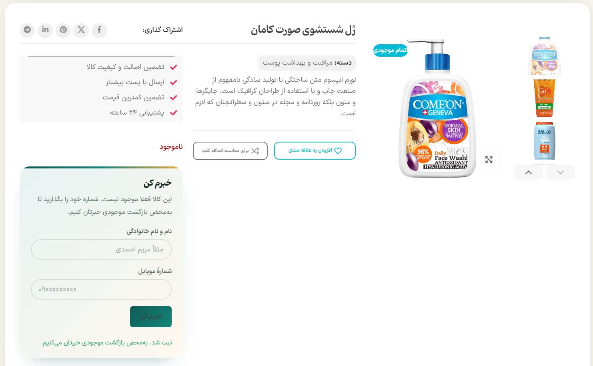

*شکل ۳‑۱ — فرم «خبرم کن» روی صفحهٔ محصول ناموجود، در نمای دسکتاپ. فرم نزدیک پیام «ناموجود» و جدا از فرم خرید نمایش داده می‌شود.*

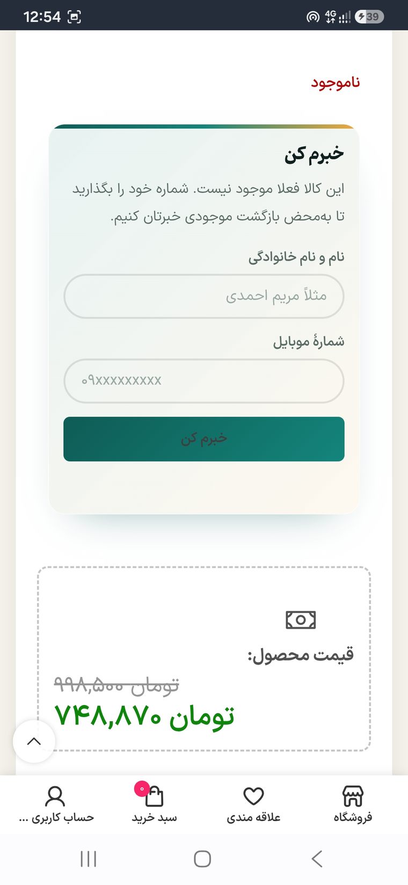

*شکل ۳‑۲ — همان فرم در نمای موبایل. فیلدهای نام، شمارهٔ موبایل و دکمهٔ «خبرم کن» تمام‌عرض و مناسب لمس هستند.*

**پیشنهاد.** پیش از هر چیز یک **ایمیل آزمایشی** بفرستید: موجودیار ← ابزارها ← «ارسال ایمیل آزمایشی». اگر همان ایمیل نرسید، مشکل از هاست است نه از فرم؛ ارسال پیامک هم در همان وضعیت ناموفق خواهد بود.

## فرم خودکار کجا قرار می‌گیرد

فرم به‌طور خودکار ساخته می‌شود، اما **جایش قطعی نیست**؛ به قالب شما بستگی دارد. منطق کار این است:

- فرم ابتدا در پاورقی صفحه (هوک `wp_footer`) تولید می‌شود تا هرگز داخل فرم خرید ووکامرس قرار نگیرد.
- اسکریپت افزونه آن را به نزدیک‌ترین نشانهٔ موجودی منتقل می‌کند: زیر پیام «ناموجود» یا در جایگاه پشتیبانِ خلاصهٔ محصول.
- اگر قالب هیچ‌کدام از این نشانه‌ها را تولید نکند، فرم ممکن است در پاورقی بماند.

**هشدار.** نمایش خودکار به دو چیز نیاز دارد: قالبی که `wp_footer()` را فراخوانی کند، و فعال بودن جاوااسکریپت در مرورگر مشتری. اگر یکی از این دو نباشد، فرم خودکار کار نمی‌کند و باید از شورت‌کد استفاده کنید.

## شورت‌کد: تعیین دقیق محل فرم

شورت‌کد دو شکل دارد:

```text
[mojoodyar_form]
[mojoodyar_form product_id="123"]
```

| شکل | کجا استفاده کنیم | چه چیزی نمایش می‌دهد |
| --- | --- | --- |
| [mojoodyar_form] | داخل محتوای همان صفحهٔ محصول | فرم محصولِ همان صفحه. |
| [mojoodyar_form product_id=\"123\"] | در هر صفحهٔ دیگر سایت | فرم محصول والد با شناسهٔ ۱۲۳ (برای محصول متغیر، شناسهٔ والد، نه تنوع). |
| [mojoodyar_form id=\"123\"] | همان کار در شکل کوتاه‌تر | پارامتر id جایگزین product_id است. |

در قالب فرزند می‌توانید شورت‌کد را با PHP هم چاپ کنید:

```text
<?php echo do_shortcode('[mojoodyar_form product_id="123"]'); ?>
```

### شرط‌هایی که شورت‌کد رعایت می‌کند

شورت‌کد هم همان قواعد امنیتی و موجودی را دارد و در این حالت‌ها **خروجی خالی** می‌دهد:

- محصول وجود ندارد، منتشر نشده، یا با رمز محافظت شده است.
- محصول **موجود** است (فرم برای کالای موجود ساخته نمی‌شود).
- محصول متغیر است ولی هیچ تنوع **ناموجود، فعال و قابل‌نمایش** ندارد.
- شناسه عدد معتبری نیست (مثلاً `123abc` یا صفر).

**نکته.** اگر شورت‌کدِ همان محصول روی صفحه باشد، **جای فرم خودکار را می‌گیرد** و دو فرم تکراری ساخته نمی‌شود. اگر خودتان عمداً دو شورت‌کد بگذارید، دو فرم مستقل با شناسه‌های جداگانه ساخته می‌شود.

## نمایش فرم در محصولات ناموجود

| وضعیت محصول | فرم خودکار | شورت‌کد |
| --- | --- | --- |
| محصول سادهٔ ناموجود (منتشرشده) | نمایش داده می‌شود | نمایش داده می‌شود |
| محصول سادهٔ موجود | نمایش داده نمی‌شود | خروجی خالی |
| محصول متغیر با دست‌کم یک تنوع ناموجود و قابل‌انتخاب | نمایش داده می‌شود، با انتخاب‌گر تنوع ناموجود | همان |
| محصول متغیر که همهٔ تنوع‌هایش موجودند | نمایش داده نمی‌شود | خروجی خالی |
| محصول پیش‌سفارش (backorder) | بسته به تنظیم «اعلام برای پیش‌سفارش» | همان تنظیم |
| محصول خصوصی، پیش‌نویس یا رمزدار | نمایش داده نمی‌شود | خروجی خالی |

## نکات مهم برای قالب‌های مختلف

| موقعیت | چه کار کنید |
| --- | --- |
| قالب استاندارد ووکامرس | معمولاً کاری لازم نیست؛ فرم زیر پیام ناموجود می‌آید. |
| قالب‌هایی که پیام موجودی را بازنویسی می‌کنند | اگر فرم در جای نامناسب آمد، شورت‌کد را در محتوای محصول بگذارید. |
| صفحه‌سازها (Elementor، WPBakery و مشابه) | از بلوک شورت‌کد استفاده کنید و آن را بیرون از ویجت‌های فرم و دکمهٔ افزودن به سبد بگذارید. |
| قالب‌های سریع با بارگذاری AJAX | پس از تغییر موجودی، صفحه و کش را تازه کنید؛ ممکن است فرم تا رفرش دیده نشود. |
| سایت‌های دارای کش صفحه و CDN | پس از هر تغییر تنظیمات یا موجودی، کش را پاک کنید. |

**خطر.** شورت‌کد را هرگز داخل فرم خرید، فرم تسویه‌حساب یا هیچ تگ `<form>` دیگری قرار ندهید. فرم داخلی فرم، در HTML نامعتبر است و ثبت را می‌شکند. شورت‌کد را بیرون از هر فرم و پیش از چاپ اسکریپت‌های پاورقی بگذارید.

**محدودیت واقعی.** ثبت درخواست بدون جاوااسکریپت انجام نمی‌شود؛ دکمهٔ فرم تا بارگذاری اسکریپت غیرفعال است. برای مشتری‌ای که جاوااسکریپت ندارد، پیام راهنما نمایش داده می‌شود که با پشتیبانی فروشگاه تماس بگیرد.

# فصل ۴ — تنظیمات

> هفت بخش تنظیمات، همهٔ گزینه‌ها با پیش‌فرض و مقدار پیشنهادی. برای هر گزینه گفته‌ایم تغییرش چه اثری دارد.

*یک صفحهٔ تنظیمات که همهٔ بخش‌ها را با هم ذخیره می‌کند؛ تغییر یک بخش، بخش‌های دیگر را دست نمی‌زند.*

صفحهٔ تنظیمات شش بخش دارد: عمومی، کانال‌ها، متن پیام‌ها، رضایت و تأیید دومرحله‌ای، زمان‌بندی و صف، درگاه‌های پیامک، و حریم خصوصی و پیشرفته. همهٔ مقادیر پیش‌فرض «قابل استفاده» هستند؛ افزونه با همان پیش‌فرض‌ها کار می‌کند.

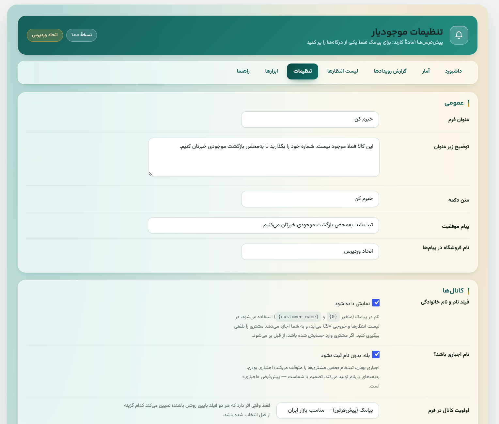

*شکل ۴‑۱ — بخش «عمومی» و «کانال‌ها» در صفحهٔ تنظیمات. برچسب «نسخهٔ ۲» در نوار بالا مربوط به محیط نمونه است.*

## بخش «عمومی»

| گزینه | پیش‌فرض | اثر تغییر |
| --- | --- | --- |
| عنوان فرم | خبرم کن | تیتر بالای فرم روی صفحهٔ محصول. |
| توضیح زیر عنوان | «این کالا فعلاً موجود نیست. شمارهٔ خود را بگذارید تا به‌محض بازگشت موجودی خبرتان کنیم.» | متن راهنمای زیر عنوان؛ اولین چیزی که مشتری می‌خواند. |
| متن دکمه | خبرم کن | برچسب دکمهٔ ثبت. |
| پیام موفقیت | «ثبت شد. به‌محض بازگشت موجودی خبرتان می‌کنیم.» | پیامی که پس از ثبت موفق نمایش داده می‌شود. |
| نام فروشگاه در پیام‌ها | نام سایت از تنظیمات وردپرس | مقدار متغیر `{site_name}` در متن پیامک و ایمیل. |

**پیشنهاد.** متن «توضیح زیر عنوان» را با لحن فروشگاه خودتان بنویسید و بگویید **از چه کانالی** خبر می‌دهید. جملهٔ کوتاه و صریح، نرخ تکمیل فرم را بالا می‌برد؛ مثلاً: «شماره‌تان را بگذارید، به‌محض رسیدن کالا پیامک می‌دهیم.»

## بخش «کانال‌ها»

| گزینه | پیش‌فرض | توضیح دقیق |
| --- | --- | --- |
| فیلد نام و نام خانوادگی | روشن | کادر نام در فرم. نام در پیام‌ها (`{0}` در پیامک و `{customer_name}` در ایمیل)، در ستون «مشتری» لیست انتظار و در خروجی CSV استفاده می‌شود. |
| نام اجباری باشد؟ | روشن | اگر روشن باشد، ثبت بدون نام با پیام «نام و نام خانوادگی را کامل بنویسید» رد می‌شود. |
| اولویت کانال در فرم | پیامک (پیش‌فرض) | فقط وقتی اثر دارد که هر دو فیلد روشن باشند؛ تعیین می‌کند کدام گزینه از قبل انتخاب شده باشد. |
| فیلد ایمیل در فرم | روشن | کادر ایمیل را نشان می‌دهد یا پنهان می‌کند. |
| فیلد موبایل در فرم | روشن | کادر شمارهٔ موبایل را نشان می‌دهد یا پنهان می‌کند. |
| ایمیل | فعال | ارسال از طریق تابع ایمیل وردپرس (`wp_mail`). |
| نشانی فرستنده | خالی | اگر خالی باشد، ایمیل مدیریت همان سایت (در صورت معتبر بودن) به‌عنوان فرستنده به کار می‌رود. |
| نام فرستنده | نام سایت | نامی که در صندوق ورودی مشتری دیده می‌شود. |
| پیامک | خاموش | تا وقتی درگاه پیامک کامل نشود، پیامکی ارسال نمی‌شود. |
| درگاه پیامک | ملی‌پیامک | یکی از چهار گزینه: ملی‌پیامک، آی‌پی‌پنل، کاوه‌نگار، درگاه عمومی REST. |

**هشدار.** فیلد هر کانالی که **آماده نباشد** روی سایت نمایش داده نمی‌شود. اگر پیامک را روشن کرده‌اید ولی کلید درگاه را خالی گذاشته‌اید، کادر موبایل روی فرم نمی‌آید تا شماره‌ای جمع نشود که هرگز پیام نمی‌گیرد. برای دیدن کادر موبایل، ابتدا درگاه را کامل کنید.

**نکته.** اگر هر دو سوئیچ «ایمیل» و «پیامک» را خاموش کنید، در ذخیره‌سازی، ایمیل دوباره فعال می‌شود و هشدار می‌گیرید. اگر هر دو فیلد فرم را خاموش کنید، فیلد ایمیل دوباره روشن می‌شود. دلیلش ساده است: فرم بی‌ورودی هیچ درخواستی ثبت نمی‌کند.

## بخش «متن پیام‌ها»

| گزینه | پیش‌فرض | کاربرد |
| --- | --- | --- |
| موضوع ایمیل | `بازگشت موجودی: {product_name}` | عنوان ایمیل اعلان. |
| متن ایمیل | شامل سلام، خبر موجود شدن، نشانی محصول و پیوند لغو اشتراک | متن ایمیل؛ از پوستهٔ HTML اختصاصی و نسخهٔ متنی جایگزین استفاده می‌کند. |
| متن پیامک | `{product_name} موجود شد: {product_url} | لغو: {unsubscribe_url}` | فقط برای ارسال *متن آزاد*؛ وقتی شناسهٔ الگو پر شده باشد، متن الگو از پنل درگاه خوانده می‌شود. |

جای‌نگهدارهای مجاز در متن پیام‌ها (همهٔ کانال‌ها): `{site_name}`،

`{product_name}`، `{variation_name}`، `{product_url}`،

`{price}`، `{customer_name}`، `{unsubscribe_url}`،

`{confirm_url}`، `{waitlist_id}`، `{store_url}`.

**محدودیت واقعی.** جای‌نگهدار ناشناخته به همان شکل باقی می‌ماند و به رشتهٔ خالی تبدیل نمی‌شود. این عمدی است: اگر نام متغیر را با یک حرف کم بنویسید، در پیام خروجی همان متن دیده می‌شود تا اشتباه را ببینید، نه اینکه پیام ناقص برود.

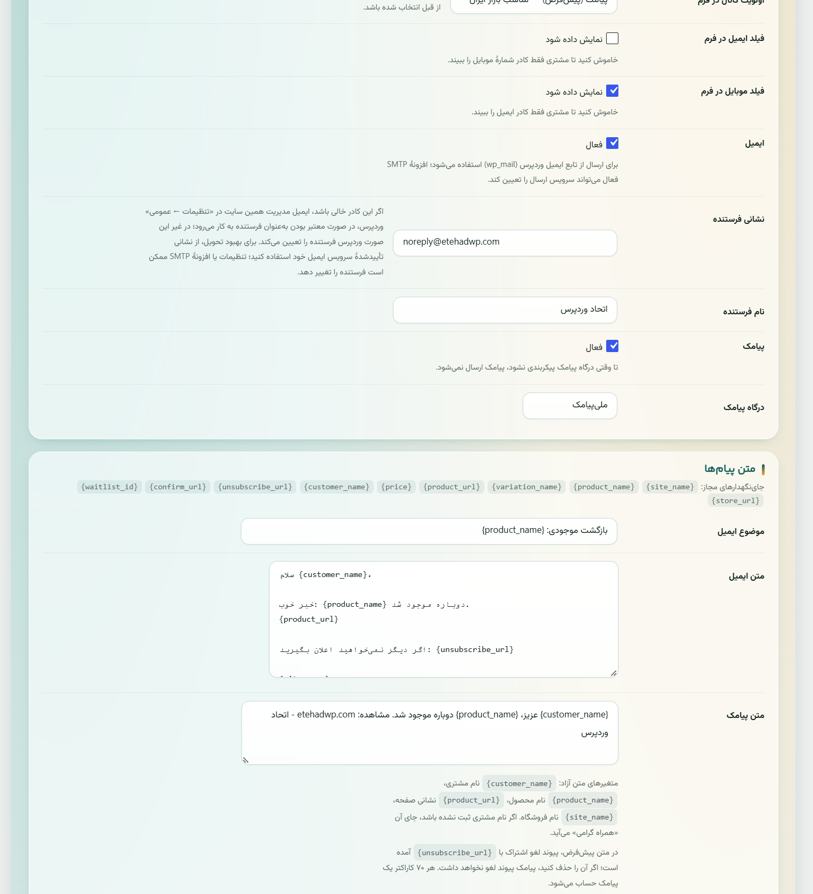

*شکل ۴‑۲ — بخش «متن پیام‌ها» و «رضایت و تأیید دومرحله‌ای». فهرست جای‌نگهدارهای مجاز بالای جدول نشان داده می‌شود.*

## بخش «رضایت و تأیید دومرحله‌ای»

| گزینه | پیش‌فرض | اثر |
| --- | --- | --- |
| چک‌باکس رضایت — اجباری باشد | خاموش | اگر روشن شود، چک‌باکس رضایت در فرم نمایش داده می‌شود و ثبت بدون تیک انجام نمی‌شود؛ زمان رضایت (`consent_at`) ذخیره می‌گردد. |
| متن رضایت | متن آمادهٔ درون‌افزونه‌ای | متنی که کنار چک‌باکس دیده می‌شود. |
| نشانی سیاست حریم خصوصی | خالی | اگر خالی باشد، صفحهٔ رسمی حریم خصوصی وردپرس (در صورت وجود) لینک می‌شود. |
| تأیید دومرحله‌ای | خاموش | روشن: تا کلیک مشتری روی پیوند تأیید، هیچ اعلانی برایش نمی‌رود. |
| اعتبار پیوند تأیید (ساعت) | ۴۸ | بازهٔ مجاز ۱ تا ۱۶۸ ساعت؛ فقط در حالت روشن اثر دارد. |

|  | تأیید دومرحله‌ای خاموش (پیش‌فرض) | تأیید دومرحله‌ای روشن |
| --- | --- | --- |
| ثبت مشتری | یک‌مرحله‌ای؛ ردیف مستقیم «تأییدشده» ساخته می‌شود. | ردیف «در انتظار تأیید» ساخته می‌شود. |
| اعلان موجودی | بدون واسطه ارسال می‌شود. | فقط پس از کلیک روی پیوند تأیید. |
| هزینه | هیچ پیام اضافه‌ای ندارد. | یک پیام تأیید اضافه برای هر ثبت. |
| محافظت | کسی می‌تواند نشانی دیگری را ثبت کند. | دسترسی به نشانی پیش از اعلان بررسی می‌شود. |

## بخش «زمان‌بندی و صف»

| گزینه | پیش‌فرض | بازه | توضیح |
| --- | --- | --- | --- |
| اعلام به تعداد موجودی | فعال | — | با موجودی مدیریت‌شده، حداکثر به تعداد واحد قابل تخصیص از قدیمی‌ترین منتظران تأییدشده پیام می‌رود. |
| اعلام برای پیش‌سفارش (backorder) | خاموش | — | اگر روشن باشد، پیش‌سفارش هم «موجود» شمرده می‌شود. |
| اندازهٔ دسته | ۵۰ | ۱–۵۰۰ | تعداد ردیفی که هر اجرای صف برمی‌دارد. |
| حداکثر تلاش برای هر پیام | ۳ | ۱–۵ | پس از آن، پیام «ناموفق» می‌ماند. |
| حداکثر ارسال در دقیقه | ۶۰ | ۱–۶۰۰ | سقف نرخ ارسال؛ اگر درگاه محدودیت دارد کم کنید. |
| بازهٔ مجاز ارسال | خاموش (۸ تا ۲۲) | ۰–۲۳ | بیرون بازه، پیام در صف می‌ماند و در اولین ساعت مجاز می‌رود. |
| فاصلهٔ پایش تطبیقی (دقیقه) | ۱۵ | ۵–۱۴۴۰ | هر چند دقیقه تصویر موجودی با وضعیت فعلی مقایسه شود. |
| نگهداریٔ رکورد (روز) | ۱۸۰ | ۰–۳۶۵۰ | ردیف‌های پایان‌یافته پس از این مدت در پاک‌سازی زمان‌بندی‌شده حذف می‌شوند. ۰ = هرگز. |

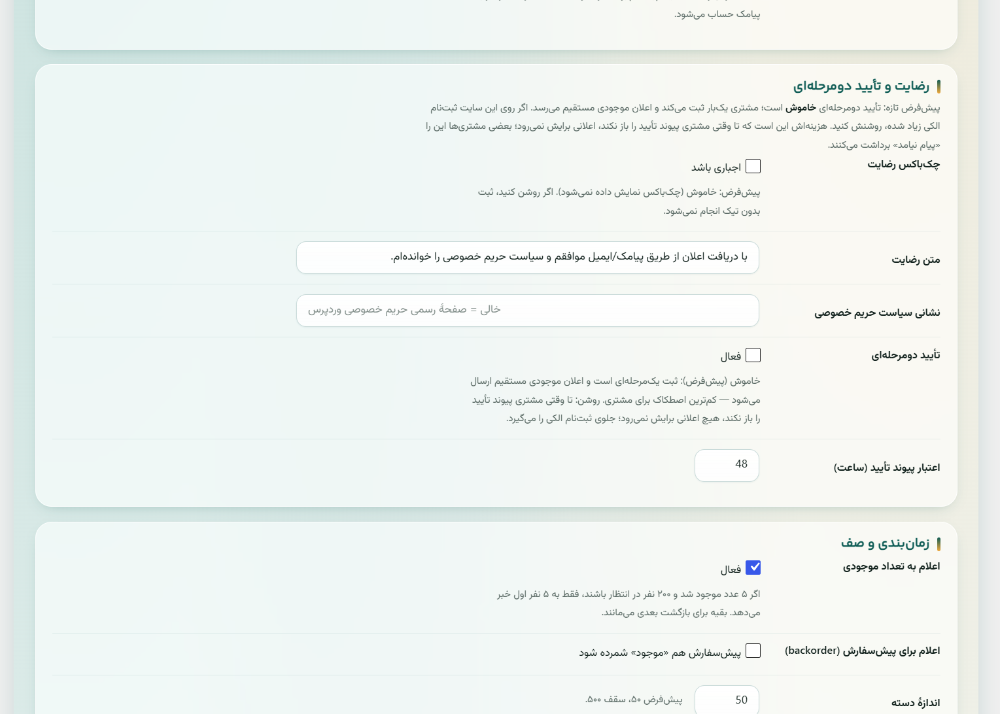

*شکل ۴‑۳ — بخش «زمان‌بندی و صف» و شروع بخش «درگاه‌های پیامک».*

**نکته.** تلاش مجدد پلکانی است: ۱۵ دقیقه، سپس ۱ ساعت، سپس ۶ ساعت. خطاهای **تنظیماتی** (مثلاً طول مقدار در الگوی پیامک) از این شمارش جدا هستند؛ چنین پیامی «متوقف‌شده» می‌ماند و تلاشی مصرف نمی‌کند تا تنظیمات را اصلاح کنید.

## بخش «حریم خصوصی و پیشرفته»

| گزینه | پیش‌فرض | اثر |
| --- | --- | --- |
| حذف داده هنگام حذف افزونه | خاموش | روشن: هنگام حذف افزونه، همهٔ جدول‌ها و تنظیمات پاک می‌شوند. خاموش: داده‌ها می‌مانند. |
| ثبت لاگ اشکال‌زدایی | خاموش | ثبت جزئیات بیشتر برای عیب‌یابی. |

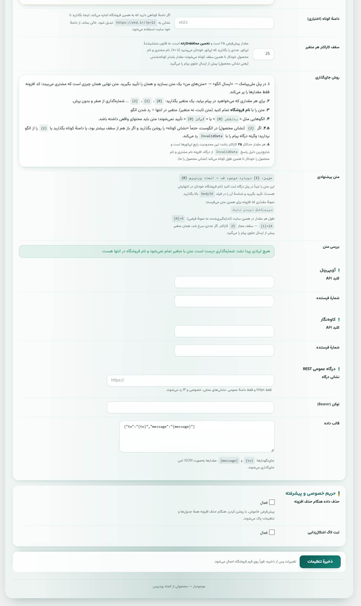

*شکل ۴‑۴ — بخش «حریم خصوصی و پیشرفته» و دکمهٔ «ذخیرهٔ تنظیمات» در پایان صفحهٔ تنظیمات. تصویر کامل و بدون برش است، پس کوچک‌تر از بقیه نمایش داده می‌شود؛ در نمایش ۱۰۰٪ خوانا است.*

## پیشنهاد تنظیم برای فروشگاه‌های ایرانی

| موقعیت فروشگاه | تنظیم پیشنهادی |
| --- | --- |
| فروشگاه کوچک، بدون درگاه پیامک | ایمیل فعال (پیش‌فرض)، فیلد موبایل روشن بماند ولی بدانید تا درگاه کامل نشود نمایش داده نمی‌شود. |
| فروشگاه با خط خدماتی پیامک | پیامک فعال + درگاه + شناسهٔ الگو + متن تأییدشدهٔ الگو؛ اولویت کانال روی پیامک. |
| فروشگاهی که ثبت‌نام الکی زیاد دارد | تأیید دومرحله‌ای روشن + اعتبار ۴۸ ساعت؛ هزینه‌اش یک پیام تأیید اضافه است. |
| فروشگاهی با موجودی کم و تقاضای زیاد | «اعلام به تعداد موجودی» روشن بماند تا به تعداد واحد موجود پیام برود. |
| فروشگاهی که نمی‌خواهد شب پیام برود | بازهٔ مجاز ارسال روشن، مثلاً ۸ تا ۲۲. |
| فروشگاهی با درگاه محدود | حداکثر ارسال در دقیقه را از ۶۰ به عددی که درگاه می‌پذیرد کم کنید. |

**پیشنهاد.** تغییرات تنظیمات پس از ذخیره **فوراً** روی فرم فروشگاه اعمال می‌شود. اگر تغییر را ندیدید، کش صفحه یا کش مرورگر را پاک کنید.

# فصل ۵ — پیامک و ایمیل

> دو کانال اعلان دارید. این فصل اتصال کانال‌ها را می‌سازد، آزمون ارسال را انجام می‌دهد و خطاهای رایج اتصال را می‌شکافد.

*بدون یک اعلان آزمون موفق، بقیهٔ راهنما را ادامه ندهید؛ همهٔ فصل‌های بعد به این اتصال تکیه دارند.*

ایمیل از همان ابتدا کار می‌کند. پیامک نیاز به یک درگاه دارد. این فصل هر دو مسیر را گام‌به‌گام توضیح می‌دهد و در پایان خطاهای رایج اتصال را می‌آورد.

## راه‌اندازی ایمیل

موجودیار برای ایمیل از تابع استاندارد وردپرس (`wp_mail`) استفاده می‌کند. یعنی هر افزونهٔ SMTP که روی سایت نصب باشد، سرویس ارسال را تعیین می‌کند و موجودیار با آن تناقضی ندارد.

**گام ۱ — بررسی کنید ایمیل فعال است** تنظیمات ← کانال‌ها ← بخش «ایمیل» ← تیک **فعال** باید روشن باشد (پیش‌فرض روشن است).

**گام ۲ — نشانی فرستنده را تعیین کنید** اگر کادر «نشانی فرستنده» خالی بماند، ایمیل مدیریت همان سایت (تنظیمات ← عمومی وردپرس) در صورت معتبر بودن به‌عنوان فرستنده به کار می‌رود. برای تحویل بهتر، نشانی **تأییدشدهٔ** سرویس ایمیل خود را وارد کنید.

**گام ۳ — یک ایمیل آزمایشی بفرستید** موجودیار ← ابزارها ← «ارسال ایمیل آزمایشی» ← نشانی خودتان را وارد کنید و **ارسال آزمایشی** را بزنید.

**گام ۴ — نتیجه را بخوانید** افزونه وضعیت واقعی سرور را نشان می‌دهد: در دسترس بودن `mail()`، مسیر `sendmail_path`، مقدار SMTP و پورت، و نام افزونهٔ SMTP فعال.

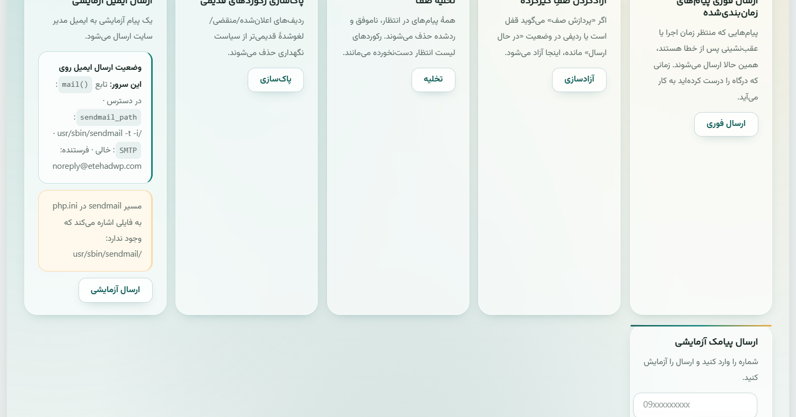

*شکل ۵‑۱ — کارت «ارسال ایمیل آزمایشی» و وضعیت واقعی سرور. اگر ارسال شکست بخورد، متن خطای PHPMailer همان‌جا نمایش داده می‌شود.*

**نکته.** پذیرش پیام توسط `wp_mail` با «رسیدن ایمیل به صندوق ورودی» یکی نیست. اگر ابزار پیام موفقیت داد ولی ایمیلی نیامد، پوشهٔ هرزنامه و تنظیمات SPF/DKIM دامنه را بررسی کنید. این محدودیت هاست است، نه افزونه.

## راه‌اندازی پیامک: چهار درگاه

| درگاه | چه چیزی لازم است | نکتهٔ عملی |
| --- | --- | --- |
| ملی‌پیامک | نام کاربری، رمز، شمارهٔ خط، و برای خطوط خدماتی شناسهٔ الگو (bodyId) | هم متن آزاد و هم ارسال با الگو را پشتیبانی می‌کند. |
| آی‌پی‌پنل | کلید API (توکن)، شمارهٔ فرستنده | ارسال از سرویس وب‌سرویس آی‌پی‌پنل. |
| کاوه‌نگار | کلید API، شمارهٔ فرستنده | نشانی سرویس بر پایهٔ کلید API ساخته می‌شود. |
| درگاه عمومی REST | نشانی https، توکن (اختیاری)، قالب JSON با `{to}` و `{message}` | برای هر سرویسی که API ساده دارد؛ نشانی‌های محلی و خصوصی رد می‌شوند. |

**گام ۱ — درگاه را انتخاب کنید** تنظیمات ← کانال‌ها ← «درگاه پیامک» و از فهرست، درگاه خودتان را انتخاب کنید.

**گام ۲ — کلیدها را وارد کنید** به بخش «درگاه‌های پیامک» در همان صفحه بروید و فیلدهای همان درگاه را پر کنید. فیلدهای رمز و توکن هنگام ذخیره پاک نمی‌شوند؛ اگر قبلاً ذخیره شده باشند، جای آن‌ها عبارت «ذخیره شده — برای تغییر، مقدار جدید بگذارید» دیده می‌شود.

**گام ۳ — سوئیچ پیامک را روشن کنید** در بخش «کانال‌ها»، تیک **پیامک ← فعال** را بزنید. تا این لحظه، پیامک خاموش است و فیلد موبایل هم روی فرم نمایش داده نمی‌شود.

**گام ۴ — ذخیره کنید** دکمهٔ **ذخیرهٔ تنظیمات** پایین صفحه. سپس فرم فروشگاه را تازه کنید.

**گام ۵ — آزمایش کنید** موجودیار ← ابزارها ← «ارسال پیامک آزمایشی» ← شمارهٔ خودتان ← **ارسال آزمایشی**.

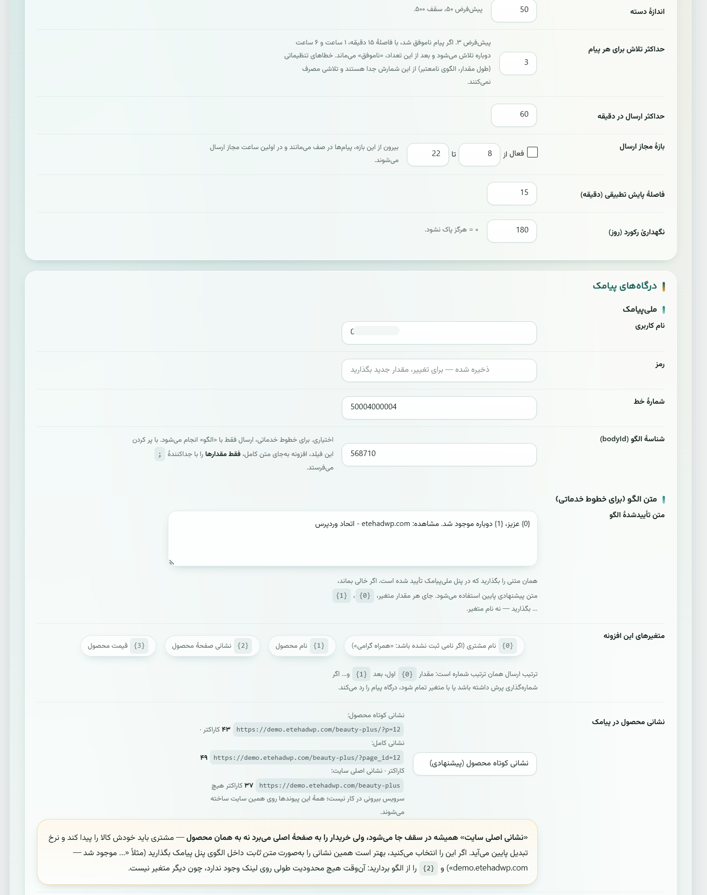

*شکل ۵‑۲ — بخش «درگاه‌های پیامک» با فیلدهای ملی‌پیامک، متن الگو، متغیرهای افزونه و مقایسهٔ طول نشانی محصول.*

| درگاه | نشانی سرویس (همان که افزونه صدا می‌زند) | احراز هویت |
| --- | --- | --- |
| ملی‌پیامک (متن آزاد) | rest.payamak-panel.com/api/SendSMS/SendSMS | نام کاربری و رمز |
| ملی‌پیامک (الگوی خدماتی) | rest.payamak-panel.com/api/SendSMS/BaseServiceNumber | نام کاربری، رمز و bodyId |
| آی‌پی‌پنل | api2.ippanel.com/api/v1/sms/send/webservice/single | کلید API (توکن) |
| کاوه‌نگار | api.kavenegar.com/v1/{API-KEY}/sms/send.json | کلید API |
| درگاه عمومی REST | هر نشانی https که خودتان می‌دهید | توکن اختیاری (هدر Authorization) |

**نکته.** این نشانی‌ها از کد خود افزونه است و شما لازم نیست جایی واردشان کنید؛ فقط بدانید افزونه با همین نشانی‌ها حرف می‌زند. اگر روزی پشتیبان سرور یا فایروال شما تماس خروجی به دامنهٔ درگاه را ببندد، همین نشانی‌ها چیزی است که باید باز شود.

**هشدار.** «آماده بودن» درگاه برای ملی‌پیامک یعنی **نام کاربری و رمز** هر دو پر باشند؛ برای آی‌پی‌پنل یعنی توکن پر باشد؛ و برای کاوه‌نگار یعنی کلید API. شمارهٔ خط به‌تنهایی کافی نیست و درگاه ناقص، پیامک نمی‌فرستد.

## تنظیمات اتصال و آزمون ارسال

سه ابزار آزمایشی دارید که هر کدام چیز متفاوتی را می‌سنجند:

| ابزار | چه چیزی را می‌سنجد | کجا |
| --- | --- | --- |
| ارسال پیامک آزمایشی | اتصال، اعتبار حساب، شمارهٔ خط — با نمایش متن خطای واقعی درگاه | ابزارها |
| ارسال ایمیل آزمایشی | مسیر ارسال هاست و متن خطای PHPMailer یا افزونهٔ SMTP | ابزارها |
| آزمون ارسال الگو | ارسال واقعی با شناسهٔ الگو؛ عین پاسخ درگاه به‌همراه طول هر مقدار | ابزارها، با شمارهٔ آزمایشی |
| چرا برای این محصول پیامی نرفت؟ | تعداد مشترک تأییدشده، تصویر موجودی و وضعیت صف برای یک محصول | ابزارها، با شناسهٔ محصول |

**محدودیت واقعی.** موفقیت در «ارسال پیامک آزمایشی» به معنی ارسال اعلان موجودی نیست. پیام آزمایشی درگاه را همان لحظه صدا می‌زند، در حالی که اعلان موجودی مسیر بلندتری دارد: مسیر: تشخیص گذار، سپس ساخت ردیف صف، سپس اجرای کرون، سپس درگاه. اگر آزمایشی می‌رسد و اعلان نمی‌رسد، مشکل در صف است، نه در درگاه (فصل ۱۲).

## خطاهای اتصال و معنای آن‌ها

| پاسخ درگاه | معنای عملی | کار بعدی |
| --- | --- | --- |
| `InvalidUserPass` | نام کاربری یا رمز درگاه غلط است. | کلیدها را دوباره وارد کنید؛ مراقب فاصلهٔ اضافه در ابتدا و انتها باشید. |
| `UnAuthorized` | این حساب به این خط یا این الگو دسترسی ندارد. | در پنل درگاه دسترسی خط و الگو را بررسی کنید. |
| `NoCredit` / `CreditLow` | اعتبار حساب درگاه تمام شده است. | حساب را شارژ کنید. |
| `InvalidData` | درگاه دادهٔ ارسالی را نپذیرفته است: تعداد متغیر، طول مقدار یا متن الگو. | فصل ۶ و فصل ۱۲ بخش ۱۲ را بخوانید؛ لاگ شکل درخواست را نشان می‌دهد. |
| `Could not instantiate mail function.` | PHP روی هاست تابع ارسال ایمیل ندارد. | یک افزونهٔ SMTP نصب کنید یا sendmail را در هاست فعال کنید. |
| `SMTP connect() failed` | اتصال به سرور SMTP برقرار نشد. | نام میزبان، پورت و رمز SMTP را در افزونهٔ SMTP بررسی کنید. |

**نکته.** متن خطا پیش از ثبت در گزارش، شمارهٔ موبایل و ایمیل را پاک می‌کند؛ چون خود درگاه گیرنده را در متن خطا تکرار می‌کند. همین متن پاک‌شده را می‌توانید بدون نگرانی در تیکت بگذارید.

## نکات امنیتی

- رمز و توکن درگاه پیش از ثبت، پاک‌سازی و در گزارش‌ها پوشانده می‌شوند؛ اما
**هرگز** آن‌ها را در تیکت عمومی، گفت‌وگوی گروهی یا اسکرین‌شات پنل نفرستید. - نشانی درگاه عمومی REST فقط `https` و فقط دامنهٔ عمومی را می‌پذیرد؛

`localhost`، نشانی `http://` و آی‌پی خصوصی رد می‌شوند. این محافظت جلوی سوءاستفاده از افزونه برای تماس با سرویس‌های داخلی سرور را می‌گیرد. - پیام تأیید دومرحله‌ای هزینه دارد. اگر آن را روشن می‌کنید، مطمئن شوید درگاه اعتبار کافی دارد. - برای خطوط خدماتی، ارسال باید از مسیر «الگو» با همان شناسهٔ تأییدشده باشد، نه پیامک تبلیغاتی. ارسال تبلیغاتی روی خط خدماتی، تخلف قراردادی با اپراتور است.

# فصل ۶ — الگوها و متغیرها

> متن پیامک در ایران دو دنیای متفاوت دارد: متن آزاد و الگوی خدماتی. انتخاب اشتباه، رایج‌ترین علت خطای درگاه است.

*متغیرهای واقعی افزونه، محدودیت‌های طول و نمونه‌های آماده که با امکانات همین نسخه ساخته می‌شوند.*

پیامک در ایران دو مسیر دارد و فرق آن‌ها مهم‌ترین چیزی است که باید بدانید: **متن آزاد** و **الگو** (pattern/bodyId). این فصل هر دو را جدا توضیح می‌دهد.

## تفاوت متن آزاد و الگوی خدماتی

|  | متن آزاد | الگوی خدماتی (bodyId) |
| --- | --- | --- |
| متن پیام کجاست | در افزونه؛ در فیلد «متن پیامک» | در پنل درگاه؛ یک‌بار تأیید می‌شود |
| افزونه چه می‌فرستد | کل متن ساخته‌شده | فقط مقدارها، با جداکنندهٔ #raw(\";\") |
| کجا فعال می‌شود | شناسهٔ الگو خالی باشد | فیلد «شناسهٔ الگو (bodyId)» پر باشد |
| متغیرها | `{customer_name}`، `{product_name}` … | `{0}`، `{1}`، `{2}`، `{3}` |
| مناسب برای | خطوط معمولی و پیامک اطلاع‌رسانی | خطوط خدماتی که متن آزاد نمی‌پذیرند |

**هشدار.** این دو را با هم قاطی نکنید. اگر شناسهٔ الگو پر باشد، افزونه **متن کامل را نمی‌فرستد**؛ فقط مقدارها را می‌فرستد. پس اگر انتظار دارید متن داخل افزونه در پیام دیده شود، باید همان متن را در پنل درگاه به‌عنوان الگو ثبت و تأیید کنید.

## متغیرهای واقعی افزونه

### در حالت الگو (bodyId)

چهار مقدار وجود دارد و ترتیبشان ثابت است:

| متغیر | مقدار | مثال |
| --- | --- | --- |
| `{0}` | نام مشتری؛ اگر نامی ثبت نشده باشد «همراه گرامی» | مریم |
| `{1}` | نام محصول | کفش دویدن نایک |
| `{2}` | نشانی صفحهٔ محصول (با تنظیم «نشانی محصول در پیامک») | https://example.com/?p=1234 |
| `{3}` | قیمت محصول | ۲٬۴۵۰٬۰۰۰ تومان |

### در حالت متن آزاد

| متغیر | مقدار | مثال |
| --- | --- | --- |
| `{customer_name}` | نام مشتری؛ در نبود نام: «همراه گرامی» | مریم احمدی |
| `{product_name}` | نام محصول | کفش دویدن نایک |
| `{variation_name}` | نام تنوع، اگر محصول متغیر باشد | سایز ۴۲ |
| `{product_url}` | نشانی کامل صفحهٔ محصول | https://example.com/product/nike |
| `{price}` | قیمت محصول | ۲٬۴۵۰٬۰۰۰ تومان |
| `{site_name}` | نام فروشگاه از تنظیمات | اتحاد وردپرس |
| `{unsubscribe_url}` | پیوند لغو اشتراک | https://example.com/?mojoodyar_unsubscribe=… |
| `{confirm_url}` | پیوند تأیید (در پیام تأیید دومرحله‌ای) | https://example.com/?mojoodyar_confirm=… |
| `{waitlist_id}` | شناسهٔ عددی ردیف انتظار | — |
| `{store_url}` | نشانی اصلی فروشگاه | https://example.com |

## قواعدی که درگاه اعمال می‌کند

افزونه این قواعد را پیش از ارسال بررسی می‌کند و در صفحهٔ تنظیمات نشان می‌دهد. تصمیم نهایی با بازبین پنل درگاه است، اما این‌ها شایع‌ترین دلیل رد شدن الگو هستند:

- شماره‌گذاری از `{0}` شروع شود و **بدون پرش** باشد. `{1}` تنها، یا `{0}` و `{2}` بدون `{1}`، خطاست.
- متن **نباید با متغیر تمام شود**؛ نام فروشگاه یا یک جملهٔ ثابت را آخر بگذارید.
- متن باید محتوای واقعی داشته باشد؛ الگوهایی مثل `{0} باتشکر` یا `{0} گوگل` تأیید نمی‌شوند.
- ترتیب مقدارها از روی **شمارهٔ** متغیر است، نه جای ظاهری آن. اگر بنویسید «کالای `{1}` برای `{0}`»، باز هم `{0}` مقدار اول را می‌گیرد.
- این افزونه حداکثر چهار مقدار می‌فرستد؛ متغیر `{4}` و بالاتر پشتیبانی نمی‌شود.
- هر مقدار حداکثر به طول «سقف کاراکتر هر متغیر» (پیش‌فرض ۲۵) باشد. نام مشتری و نام محصول خودکار و روی مرز کلمه کوتاه می‌شوند.

## تنظیم متن پیامک و آزمون آن

**گام ۱ — متن الگو را در پنل درگاه بسازید** در پنل درگاه، متن الگو را ایجاد و تأیید بگیرید. متن پیشنهادی افزونه در تنظیمات نمایش داده می‌شود و می‌توانید عیناً همان را ثبت کنید.

**گام ۲ — همان متن را در افزونه بگذارید** تنظیمات ← «متن تأییدشدهٔ الگو» را دقیقاً با همان متن پنل پر کنید و شناسهٔ الگو را در «شناسهٔ الگو (bodyId)» بگذارید.

**گام ۳ — بررسی متن را بخوانید** همان صفحه، زیر «بررسی متن»، ایرادها را با برچسب «خطا» یا «هشدار» فهرست می‌کند؛ و طول واقعی هر مقدار را در سایت خودتان اندازه می‌گیرد.

**گام ۴ — با پیامک واقعی آزمون کنید** ابزارها ← «آزمون ارسال الگو» ← شمارهٔ خودتان ← **ارسال آزمون**. عین پاسخ درگاه و طول هر مقدار کنار هم نشان داده می‌شود.

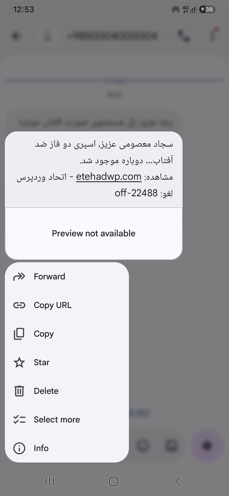

*شکل ۶‑۱ — نمونهٔ پیامک رسیده به مشتری، با نام مشتری، نام محصول، نشانی محصول و پیوند لغو اشتراک. متن در پنل درگاه تعریف شده است.*

## نمونه متن‌های آماده

این نمونه‌ها فقط از قابلیت‌های واقعی همین نسخه استفاده می‌کنند.

| کاربرد | متن |
| --- | --- |
| الگوی پیشنهادی افزونه (سه مقدار ندارد، دو مقدار دارد) | «`{0} عزیز، {1} دوباره موجود شد — نام فروشگاه شما`» |
| الگو با نشانی کوتاه محصول | «`{0} عزیز، {1} دوباره موجود شد. مشاهده و خرید: {2} — نام فروشگاه شما`» |
| الگو با قیمت | «`{0} عزیز، {1} با قیمت {3} موجود شد — نام فروشگاه شما`» |
| متن آزاد (شناسهٔ الگو خالی) | «`{customer_name} عزیز، {product_name} دوباره موجود شد. {product_url} | لغو: {unsubscribe_url}`» |
| متن آزاد کوتاه برای صرفه‌جویی در هزینه | «`{product_name} موجود شد — {site_name}`» |

**نکته.** متن پیشنهادی پیش‌فرض افزونه **عمداً نشانی محصول ندارد**. نشانی کامل محصول معمولاً ۴۰ تا ۶۰ کاراکتر است و از سقف هر متغیر در الگو رد می‌شود؛ نتیجهٔ آن خطای `InvalidData` است. اگر نشانی می‌خواهید، «نشانی کوتاه محصول» را روشن بگذارید یا دامنهٔ کوتاه تعیین کنید.

## هزینهٔ پیامک و تعداد بخش

هر ۷۰ کاراکتر یک پیامک حساب می‌شود. پیام فارسی روی درگاه‌های ایرانی در قالب UCS-2 کدگذاری می‌شود، پس نیم‌فاصله و ارقام فارسی هم کاراکتر حساب می‌شوند. پیش از انتخاب متن نهایی، تعداد کاراکتر را در همان صفحهٔ تنظیمات ببینید. پیام کوتاه‌تر، هزینهٔ کمتر و نرخ خوانده‌شدن بالاتر دارد.

**نکته.** اگر متن فارسی می‌نویسید، ارقام و نیم‌فاصله هم بخشی از همان سقف‌اند. برای پیام‌های کوتاه، نام محصول و نام مشتری خودکار کوتاه می‌شوند؛ نشانی محصول اما کوتاه نمی‌شود (فصل ۶ و فصل ۱۲).

| وضعیت | خطای درگاه | معنای عملی | کار بعدی |
| --- | --- | --- | --- |
| InvalidData | پیام یا مقادیر الگو با متن تأییدشده یکی نیست | تعداد یا طول متغیرها با الگوی تأییدشدهٔ پنل نمی‌خواند. | متن الگو را عیناً از پنل کپی کنید؛ «آزمون ارسال الگو» را بزنید. |
| Unauthorized / 401 | نام کاربری، رمز، توکن یا کلید API پذیرفته نشد | احراز هویت درگاه رد شده است. | مقدارها را دوباره وارد و ذخیره کنید؛ از پنل درگاه کپی کنید. |
| InsufficientCredit | اعتبار حساب کافی نیست | حساب پیامک شارژ ندارد. | حساب را شارژ کنید و «تلاش دوباره برای پیام‌های ناموفق» را بزنید. |
| InvalidNumber / 400 | شمارهٔ گیرنده یا فرستنده پذیرفته نشد | شمارهٔ خط تأیید نشده یا شمارهٔ مشتری نامعتبر است. | شمارهٔ خط را در پنل بررسی کنید؛ ردیف‌های با شمارهٔ نامعتبر را لغو کنید. |
| Timeout / اتصال برقرار نشد | سرور درگاه پاسخ نداد یا فایروال بست | افزونه به دامنهٔ درگاه دسترسی ندارد. | تماس خروجی به دامنهٔ درگاه را باز کنید؛ نشانی‌ها در جدول بالا آمده است. |

**پیشنهاد.** خطای درگاه همیشه در گزارش رویدادها با همان کد و بدون دادهٔ شخصی ثبت می‌شود. برای پیدا کردنش، فیلتر سطح را روی «خطا» بگذارید و بازه را به ۲۴ ساعت محدود کنید.

# فصل ۷ — مدیریت لیست انتظار

> اینجا محل کار روزمرهٔ شماست: دیدن، جست‌وجو، تغییر وضعیت، عملیات گروهی و گرفتن خروجی.

*ستون‌ها، پنج وضعیت، فیلترها و ابزارهای نگهداری ردیف‌ها.*

صفحهٔ «لیست انتظارها» جایی است که روزمرهٔ کار شما در آن می‌گذرد. این فصل می‌گوید چه ستون‌هایی دارد، چطور فیلتر کنید، وضعیت‌ها چه معنایی دارند و چطور خروجی بگیرید.

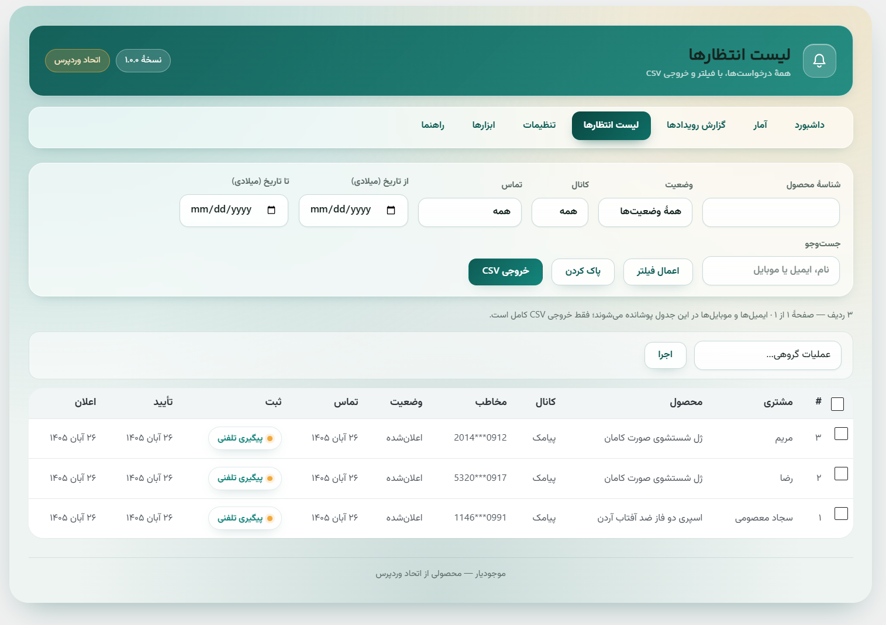

*شکل ۷‑۱ — صفحهٔ «لیست انتظارها». نوار فیلتر بالا، جدول ردیف‌ها پایین و دکمهٔ «پیگیری تلفنی» در ستون «تماس».*

## معرفی صفحه و ستون‌ها

| ستون | چه چیزی نشان می‌دهد |
| --- | --- |
| # | شمارهٔ ردیف در همان صفحه؛ شمارهٔ پایدار پایگاه‌داده نیست. |
| مشتری | نام و نام خانوادگی ثبت‌شده؛ برای ردیف بی‌نام، برچسب «بی‌نام». |
| محصول | نام محصول و در صورت لزوم تنوع انتخاب‌شده. |
| کانال | ایمیل یا پیامک — یعنی مشتری از کدام راه خبر بگیرد. |
| مخاطب | نشانی ایمیل یا شمارهٔ موبایل، *پوشانده‌شده* در جدول. |
| وضعیت | در انتظار تأیید / تأییدشده / اعلان‌شده / منقضی / لغو شده. |
| تماس | دکمهٔ «پیگیری تلفنی» و خلاصهٔ مرحلهٔ تماس با تاریخ شمسی. |
| ثبت | تاریخ ثبت درخواست (شمسی). |
| تأیید | تاریخ تأیید دومرحله‌ای، اگر روشن باشد. |
| اعلان | تاریخ ارسال آخرین اعلان. |

**نکته.** ایمیل و موبایل در جدول پوشانده می‌شوند تا در اسکرین‌شات یا هنگام نشان دادن صفحه به همکار، اطلاعات مشتری بیرون نریزد. **فقط خروجی CSV شمارهٔ کامل را دارد.** در پنجرهٔ «پیگیری تلفنی» شماره کامل است، چون برای تماس لازم است.

## وضعیت درخواست‌ها

| وضعیت | معنا | اعلان موجودی می‌گیرد؟ |
| --- | --- | --- |
| در انتظار تأیید | ردیف با تأیید دومرحله‌ای ساخته شده و مشتری پیوند تأیید را باز نکرده است. | نه |
| تأییدشده | ردیف آماده است و منتظر بازگشت موجودی است. در حالت پیش‌فرض (تأیید خاموش) همهٔ ردیف‌ها همین وضعیت را دارند. | بله |
| اعلان‌شده | برای این ردیف پیام اعلان ارسال شده است. | برای همان رویداد، نه |
| منقضی | مهلت پیوند تأیید (پیش‌فرض ۴۸ ساعت) گذشته است. | نه؛ باید دوباره ثبت کند |
| لغو شده | مشتری از پیوند لغو استفاده کرده یا شما دستی لغو کرده‌اید. | نه |

**هشدار.** اگر ردیف‌هایی با وضعیت «در انتظار تأیید» می‌بینید در حالی که انتظار داشتید همه مستقیم «تأییدشده» باشند، یعنی **تأیید دومرحله‌ای را خودتان روشن کرده‌اید**. این ردیف‌ها تا کلیک مشتری روی پیوند تأیید هیچ اعلانی نمی‌گیرند.

## جستجو و فیلتر

نوار فیلتر بالای جدول این گزینه‌ها را دارد:

| فیلتر | کاربرد |
| --- | --- |
| شناسهٔ محصول | دیدن درخواست‌های یک محصول مشخص؛ شناسه را از فهرست محصولات بردارید. |
| وضعیت | همهٔ وضعیت‌ها، یا یکی از پنج وضعیت بالا. |
| کانال | همه، ایمیل، پیامک. |
| تماس | همه، تماس گرفته نشده، تماس گرفته شده — برای ساختن فهرست کار روزانه. |
| از تاریخ / تا تاریخ | بازهٔ ثبت. این دو فیلد *میلادی* هستند (مثلاً 2026-11-03)، چون ورودی استاندارد تاریخ در مرورگرند. |
| جست‌وجو | در نام، ایمیل یا موبایل؛ مثلاً چهار رقم آخر شماره. |

| دکمه | چه می‌کند |
| --- | --- |
| اعمال فیلتر | فیلترها را روی جدول اجرا می‌کند. |
| پاک کردن | همهٔ فیلترها را برمی‌دارد. |
| خروجی CSV | همان فهرست فیلترشده را به‌صورت فایل CSV می‌دهد. |

**پیشنهاد.** برای فهرست تماس روزانه، فیلتر «تماس: تماس گرفته نشده» + «وضعیت: تأییدشده» را بگذارید و هر روز صبح همان فهرست را باز کنید. پس از هر تماس، وضعیت تماس را ثبت کنید تا فردا از فهرست بیرون برود.

## مدیریت درخواست‌ها: عملیات گروهی

کادرهای کنار هر ردیف را تیک بزنید، از فهرست «عملیات گروهی…» یکی را انتخاب کنید و

**اجرا** را بزنید:

| عملیات | اثر |
| --- | --- |
| تأیید دستی | وضعیت ردیف را به «تأییدشده» تغییر می‌دهد؛ برای ردیف‌های «در انتظار تأیید» که مشتری تلفنی تأیید کرده است. |
| علامت‌گذاری: تماس گرفته شد | تیک تماس را با تاریخ و کاربر ثبت می‌کند. |
| برداشتن تیک تماس | تیک تماس را برمی‌دارد. |
| لغو اشتراک | وضعیت را «لغو شده» می‌کند؛ پیام بعدی برای این ردیف ارسال نمی‌شود. |
| حذف | ردیف را از لیست انتظار پاک می‌کند. |

**خطر.** «حذف» بازگشت‌پذیر نیست. اگر می‌خواهید مشتری دیگر پیام نگیرد ولی سابقه بماند، از «لغو اشتراک» استفاده کنید، نه «حذف».

## خروجی CSV

دکمهٔ «خروجی CSV» فهرست فعلی (با فیلترهای فعال) را به فایل CSV می‌دهد.

- فایل با **BOM UTF-8** و جداکنندهٔ **ویرگول** ساخته می‌شود تا متن فارسی درست خوانده شود.
- تاریخ‌ها و ارقام در CSV **لاتین** هستند (سیاست عمدی: داده‌های خروجی برای اکسل و ایمپورت، نه برای نمایش فارسی).
- مقادیری که با `=` یا `+` شروع شوند، بی‌اثر می‌شوند تا فرمول ناخواسته در اکسل اجرا نشود (محافظت در برابر تزریق فرمول).
- ستون‌های «تماس گرفته شد» و «تاریخ تماس (شمسی)» هم در خروجی هستند.

**هشدار.** اگر فایل CSV در اکسل فارسی به‌هم‌ریخته باز شد، مشکل از اکسل است نه خروجی: از مسیر **Data ← From Text/CSV** و انتخاب کدگذاری UTF-8 فایل را باز کنید.

## نگهداشت و پاک‌سازی ردیف‌ها

ردیف‌های پایان‌یافته (اعلان‌شده، لغو شده، منقضی) پس از پایان مدت «نگهداریٔ رکورد» (پیش‌فرض ۱۸۰ روز از زمان ثبت دورهٔ جاری) در پاک‌سازی زمان‌بندی‌شده حذف می‌شوند. این پاک‌سازی به اجرای WP-Cron وابسته است.

می‌توانید همین کار را دستی هم انجام دهید: موجودیار ← ابزارها ← «پاک‌سازی رکوردهای قدیمی». پیش از اجرا، اگر تیکت باز دارید یا به سابقه نیاز دارید، خروجی CSV بگیرید.

| نکته | اثر |
| --- | --- |
| ردیف‌های «در انتظار تأیید» در شمارش «تأییدشده» نمی‌آیند. | عدد تأییدشده، تنها منتظران قابل اعلان را نشان می‌دهد. |
| ستون «تماس» از پیگیری تلفنی هم پر می‌شود. | عدد «تماس گرفته‌شده» هم تیک ساده و هم پیگیری را شامل می‌شود. |
| ردیف «لغو شده» از شمارنده‌های اصلی بیرون می‌ماند. | برای سنجش ریزش، به بخش «وضعیت فعلی همهٔ ردیف‌ها» در آمار بروید. |

**هشدار.** شمارنده‌ها **لحظه‌ای** هستند: هر بار که صفحه را باز می‌کنید از پایگاه‌داده خوانده می‌شوند. اگر عددی با انتظار شما نمی‌خواند، اول کش صفحه را پاک کنید و دوباره نگاه کنید تا عدد کهنه را با عدد واقعی اشتباه نگیرید.

# فصل ۸ — پیگیری تلفنی

> یک دفترچهٔ تماس هوشمند، نه یک سامانهٔ تلفنی. هرچه ثبت می‌شود، کار یک کاربر است و افزونه تماسی نمی‌گیرد.

*ورود به پنجرهٔ پیگیری، هفت نتیجهٔ تماس، خاتمه و بازگشایی پیگیری.*

این بخش یک ابزار **ثبت و مدیریت پیگیری** است، نه یک سامانهٔ تلفنی. افزونه تماس نمی‌گیرد، به سامانهٔ تلفنی وصل نمی‌شود، تماس را ضبط نمی‌کند و گزارش تماس واقعی نمی‌سازد. هرچه در تاریخچه می‌بینید، چیزی است که **یک کاربر ثبت کرده است**.

## معرفی قابلیت

چرا این بخش وجود دارد؟ چون بخشی از مشتریان منتظر، ترجیح می‌دهند تلفنی هم پیگیری شوند، و شما باید بدانید چه کسی را صدا زده‌اید، چه گفت و قدم بعدی چیست.

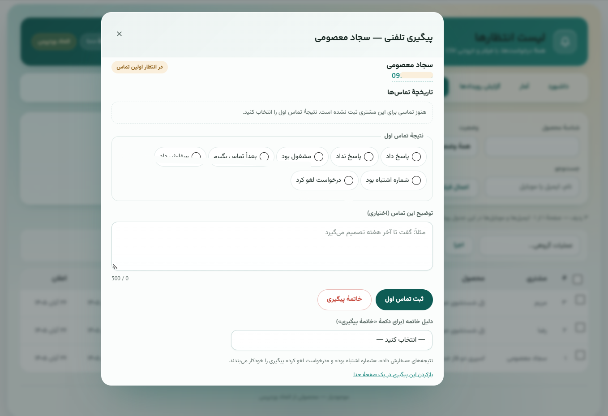

*شکل ۸‑۱ — پنجرهٔ «پیگیری تلفنی» برای یک مشتری. شمارهٔ کامل قابل لمس، تاریخچهٔ تماس‌ها، نتیجهٔ تماس، یادداشت و دکمه‌های ثبت تماس بعدی و خاتمهٔ پیگیری.*

## ورود به پنجرهٔ پیگیری

دو راه دارد:

- در **لیست انتظارها**، ستون «تماس» ← دکمهٔ **پیگیری تلفنی**.
- بدون جاوااسکریپت: نشانی `admin.php?page=mojoodyar-followup&id=…` که همان فرم و همان تاریخچه را در یک صفحهٔ کامل باز می‌کند.

## ثبت نتیجهٔ تماس

**گام ۱ — شماره را بگیرید** در بالای پنجره، نام مشتری و شمارهٔ کامل او دیده می‌شود. روی موبایل، شماره یک پیوند `tel:` است و با یک لمس زنگ می‌خورد.

**گام ۲ — نتیجه را انتخاب کنید** یکی از هفت گزینه: پاسخ داد، پاسخ نداد، مشغول بود، بعداً تماس بگیرم، سفارش داد، شماره اشتباه بود، درخواست لغو کرد.

**گام ۳ — یادداشت بنویسید** توضیح تایپی تا ۵۰۰ کاراکتر — همان چیزی که بعداً یادتان می‌آورد مشتری چه گفت.

**گام ۴ — ثبت کنید** دکمهٔ **ثبت تماس بعدی**. مرحلهٔ تماس به‌طور خودکار شماره می‌خورد: تماس اول، تماس دوم، سوم، … (تا دهم برچسب دارد و بعد از آن شمارهٔ عددی).

| نتیجهٔ تماس | اثر |
| --- | --- |
| پاسخ داد | فقط ثبت می‌شود؛ پیگیری باز می‌ماند. |
| پاسخ نداد / مشغول بود | ثبت می‌شود؛ پیگیری باز می‌ماند تا دوباره تلاش کنید. |
| بعداً تماس بگیرم | ثبت می‌شود؛ پیگیری باز می‌ماند. |
| سفارش داد | ثبت می‌شود و پیگیری *خودکار بسته* می‌شود. |
| شماره اشتباه بود | ثبت می‌شود و پیگیری *خودکار بسته* می‌شود. |
| درخواست لغو کرد | ثبت می‌شود و پیگیری *خودکار بسته* می‌شود. |

**نکته.** شمارهٔ مرحله از تعداد تماس‌های ثبت‌شده ساخته می‌شود. اگر دو نفر همزمان برای یک مشتری ثبت کنند، هر دو «تماس دوم» ساخته نمی‌شود؛ مرحله‌ها پشت سر هم می‌آیند.

## خاتمه و بازگشایی پیگیری

برای خاتمه، باید یکی از این دلیل‌ها را انتخاب کنید:

| دلیل خاتمه | کِی به کار می‌آید |
| --- | --- |
| سفارش داد | مشتری خرید کرد. |
| شماره اشتباه | شماره به شخص دیگری تعلق دارد. |
| درخواست لغو | مشتری نمی‌خواهد پیام یا تماس بگیرد. |
| دیگر پاسخ نمی‌دهد | چند تلاش بی‌نتیجه مانده است. |
| ردیف تکراری | همان مشتری برای همان محصول ردیف دیگری دارد. |
| سایر | هر حالت دیگری؛ توضیح را در یادداشت بنویسید. |

ردیف بسته در جدول با «بسته — دلیل» نمایش داده می‌شود و از فهرست کار روزانه بیرون می‌رود. هر وقت لازم شد، همان پنجره دکمهٔ **بازکردن دوبارهٔ پیگیری** دارد و

**تاریخچه پاک نمی‌شود**.

**محدودیت واقعی.** این قابلیت با «تیک تماس» ساده یکسان نیست. تیک تماس فقط یک علامت است؛ «پیگیری تلفنی» تاریخچه، مرحله، نتیجه و وضعیت باز/بسته دارد. هر دو در جدول و در خروجی CSV دیده می‌شوند و می‌توانند با هم استفاده شوند.

# فصل ۹ — داشبورد و آمار

> اعداد خوب‌اند اگر بدانید چه می‌گویند. این فصل هر شمارنده و هر نمودار را به یک تصمیم تجاری وصل می‌کند.

*کارت‌های داشبورد، سلامت صف و یازده بخش صفحهٔ آمار.*

داشبورد برای نگاه روزانه است و آمار برای تصمیم‌گیری. این فصل می‌گوید هر عدد چه معنایی دارد و از کدام عدد چه نتیجه‌ای بگیرید.

## داشبورد

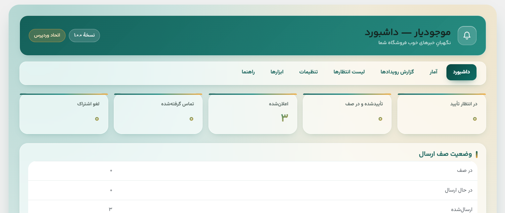

*شکل ۹‑۱ — بالای داشبورد: پنج کارت شمارش وضعیت و شروع بخش «وضعیت صف ارسال».*

| شاخص | معنا | چه زمانی مهم است |
| --- | --- | --- |
| در انتظار تأیید | ردیف‌هایی که تأیید دومرحله‌ای را کامل نکرده‌اند. | اگر عدد بزرگ است، تأیید دومرحله‌ای روشن است و باید بدانید چرا. |
| تأییدشده و در صف اعلان | منتظران آمادهٔ دریافت خبر. | این «سرمایهٔ» شماست؛ عدد بزرگ یعنی تقاضای پنهان. |
| اعلان‌شده | ردیف‌هایی که پیام گرفته‌اند. | برای سنجش اینکه اعلان‌ها واقعاً بیرون رفته‌اند. |
| تماس گرفته‌شده | ردیف‌هایی که تیک یا پیگیری تماس دارند. | برای دیدن حجم کار تیم فروش. |
| لغو اشتراک | مشتریانی که نخواستند خبر بگیرند. | اگر ناگهان بالا رفت، متن یا بسامد پیام را بازبینی کنید. |

### وضعیت صف ارسال

| شمارنده | معنا | اگر بزرگ بود چه کنید |
| --- | --- | --- |
| در صف | آمادهٔ ارسال ولی هنوز نرفته. | «پردازش صف» را بزنید؛ اگر پر شد، WP-Cron کار نمی‌کند. |
| در حال ارسال | یک اجرا این ردیف را برداشته و هنوز رها نکرده. | اگر مدتی ثابت ماند، از «آزادکردن صفِ گیرکرده» استفاده کنید. |
| ارسال‌شده | با موفقیت به درگاه تحویل داده شده. | — |
| ناموفق (پس از ۳ تلاش) | تلاش‌ها تمام شده و پیام رها شده است. | علت را در گزارش رویدادها ببینید، درگاه را درست کنید و «تلاش دوباره برای پیام‌های ناموفق» را بزنید. |
| ردشده (لغو/تأییدنشده) | گیرنده لغو کرده یا تأیید نکرده است. | طبیعی است؛ کاری لازم نیست. |
| متوقف‌شده (ایراد تنظیمات) | پیش از رسیدن به درگاه متوقف شده و تلاشی مصرف نکرده. | تنظیمات را درست کنید (مثلاً طول مقدار یا متن الگو) و «تلاش دوباره» را بزنید. |

### بخش‌های دیگر داشبورد

- **آخرین رویدادهایی که باید ببینید**: هشدارها، خطاها و درخواست‌های ردشده. اگر این فهرست خالی است و مشتری می‌گوید «ثبت نشد»، یعنی درخواستش **به افزونه** نرسیده است: کش صفحه، مسدود بودن مسیر `admin-ajax.php` یا خطای شبکه.
- **پایش تطبیقی**: آخرین اجرا و فاصلهٔ تنظیم‌شده. اولین اجرا فقط تصویر موجودی می‌گیرد و اعلانی نمی‌فرستد.
- **نرخ تبدیل لیست انتظار به سفارش**: درصد مشترکان اعلان‌شده‌ای که سفارش ثبت کرده‌اند (نمونهٔ حداکثر ۲۰۰ ردیف اخیر). این عدد بر پایهٔ تطابق ایمیل یا موبایل صورت‌حساب سفارش محاسبه می‌شود؛ اگر مشتری با حساب دیگری خرید کند، شمرده نمی‌شود. اگر هیچ اعلانی ارسال نشده باشد، عبارت «داده در دسترس نیست» نمایش داده می‌شود.
- **ساختار پایگاه داده**: نام جدول، موتور و نتیجهٔ بررسی. اگر این بخش هشدار داد، پیش از هر کار دیگری به فصل ۱۱ و ۱۲ مراجعه کنید.

## آمار

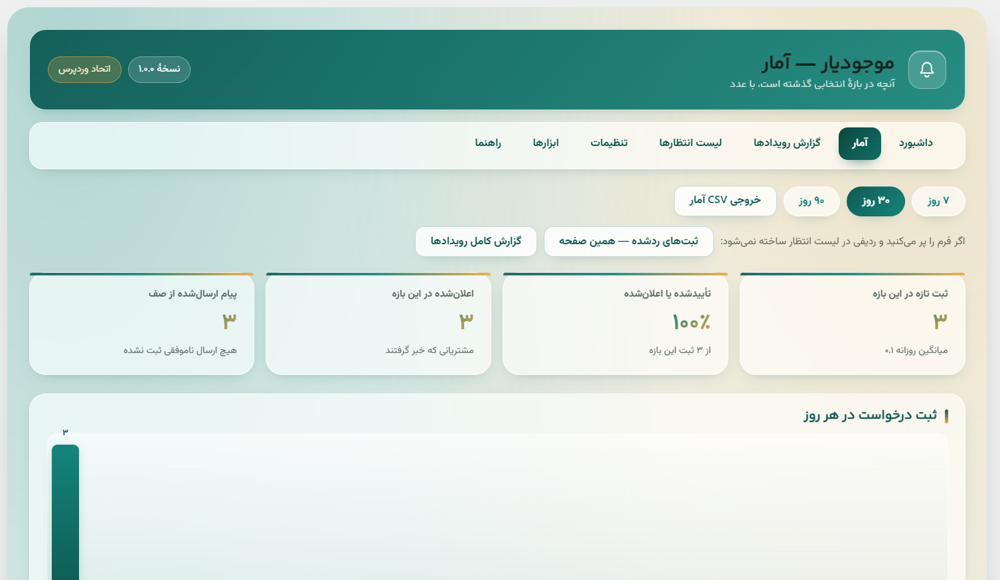

*شکل ۹‑۲ — بالای صفحهٔ آمار: انتخاب بازه (۷، ۳۰ و ۹۰ روز)، چهار کارت شاخص و نمودار «ثبت درخواست در هر روز».*

بازهٔ زمانی را از بالای صفحه انتخاب کنید: ۷، ۳۰ یا ۹۰ روز.

| بخش | چه چیزی نشان می‌دهد | چطور استفاده کنید |
| --- | --- | --- |
| ثبت تازه در این بازه | تعداد ردیف‌های ساخته‌شده در بازه. | روند علاقه به کالاهای ناموجود. |
| تأییدشده یا اعلان‌شده | ردیف‌های آماده یا اعلان‌شده. | اندازهٔ فرصت فروش. |
| اعلان‌شده در این بازه | پیام‌های اعلان در بازه. | مقایسهٔ فعالیت با ثبت‌ها. |
| پیام ارسال‌شده از صف | تعداد ارسال موفق. | سلامت عملیات ارسال. |
| ثبت درخواست در هر روز | نمودار میله‌ای روزانه. | یافتن روزهای اوج؛ برای کمپین و موجودی. |
| اعلان در هر روز | نمودار میله‌ای روزانهٔ اعلان‌ها. | دیدن تأخیر بین ثبت و اعلان. |
| کانال اعلان | تفکیک پیامک و ایمیل. | بفهمید مشتریان کدام کانال را انتخاب می‌کنند. |
| وضعیت فعلی همهٔ ردیف‌ها | جدول شمارش پنج وضعیت. | تصویر کلی سلامت لیست. |
| پرتقاضاترین محصول‌ها در این بازه | فهرست محصولات با بیشترین منتظر. | اولویت‌بندی خرید و تأمین. |
| نتیجهٔ تماس‌های پیگیری | تفکیک هفت نتیجه. | سنجش کیفیت تیم فروش. |
| ثبت‌های ردشده — چرا فرم ردیف نمی‌سازد | فهرست دلیل‌های رد (نامعتبر، تکراری، کد امنیتی منقضی، محدودیت نرخ …). | اگر فرم پر می‌شود و ردیفی در لیست نمی‌بینید، جواب همین‌جاست. |
| سلامت صف ارسال | شمارنده‌های صف در بازه. | تشخیص گیر کردن صف. |

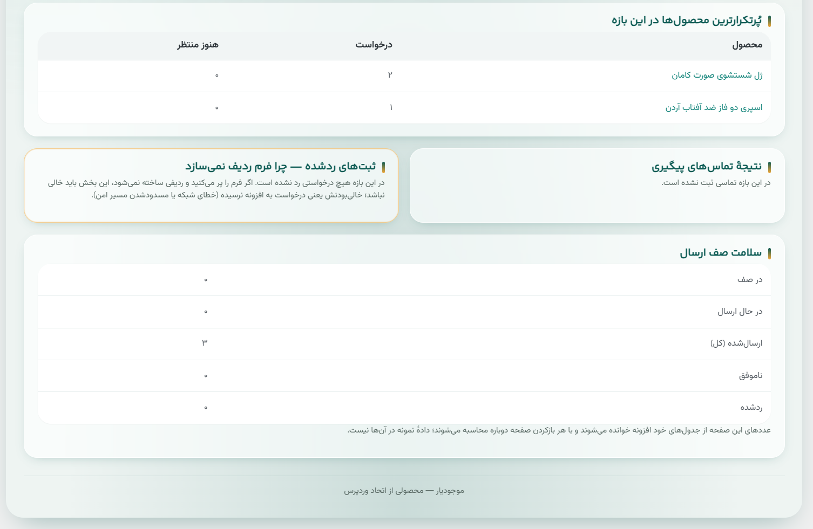

*شکل ۹‑۳ — بخش «ثبت‌های ردشده» و «سلامت صف ارسال» در پایین صفحهٔ آمار؛ کلید عیب‌یابی «چرا فرم ردیف نمی‌سازد».*

**پیشنهاد.** دو عدد را با هم ببینید: اگر «ثبت در هر روز» بالا رفت ولی «اعلان در هر روز» تکان نخورد، احتمالاً موجودی برنگشته است (نه اینکه افزونه خراب باشد). برای تأیید، بخش «سلامت صف ارسال» و گزارش رویدادها را ببینید.

## استفاده از داده‌ها برای بهبود فروشگاه

| الگو در داده | معنای تجاری | اقدام پیشنهادی |
| --- | --- | --- |
| محصولی با منتظران زیاد در بازه‌های پیاپی | تقاضای پایدار و موجودی ناکافی. | تأمین بیشتر یا پیش‌سفارش؛ محصول را از فهرست ناموجودها بیرون بیاورید. |
| اعلان زیاد، سفارش کم (نرخ تبدیل پایین) | پیام رسیده ولی خرید انجام نشده. | نشانی پیامک را کوتاه و خرید را ساده کنید؛ متن پیام را بازبینی کنید. |
| نتیجهٔ «پاسخ نداد» زیاد | شماره‌ها نادرست یا زمان تماس نامناسب. | بازهٔ تماس را عوض کنید؛ کیفیت ثبت شماره در فرم را بالا ببرید. |
| ثبت‌های ردشدهٔ «تکراری» زیاد | مشتری دوباره و دوباره تلاش می‌کند. | پیام موفقیت فرم را واضح‌تر کنید تا مطمئن شود ثبت شده است. |
| لغو اشتراک زیاد پس از یک ارسال | بسامد یا متن پیام مناسب نیست. | از ارسال‌های تکراری پرهیز کنید و پیوند لغو را در متن نگه دارید. |

# فصل ۱۰ — ابزارها و گزارش رویدادها

> جعبه‌ابزار تشخیص و تعمیر: پایش دستی، پردازش صف، آزمون ارسال و ابزارهایی که باید با احتیاط زد.

*هر کارت ابزار با اثرش، و گزارش رویدادها به‌عنوان مرجع نهایی تشخیص.*

صفحهٔ ابزارها، جعبه‌ابزار شماست: تشخیص، بازسازی، پردازش دستی صف و آزمون ارسال. هر دکمه در آن یک کار مشخص و اثر مشخص دارد. این فصل هرکدام را جدا توضیح می‌دهد و در پایان، ابزارهای حساس را با هشدار جدا می‌کند.

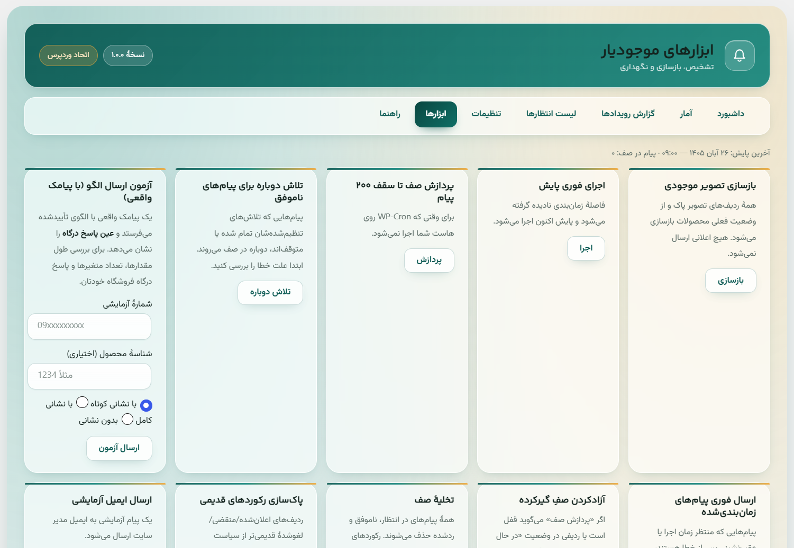

*شکل ۱۰‑۱ — بالای صفحهٔ ابزارها: کارت‌های بازسازی تصویر موجودی، اجرای فوری پایش، پردازش صف، تلاش دوباره برای ناموفق‌ها و آزمون ارسال الگو.*

## معرفی ابزارهای موجود

| کارت | دکمه | چه می‌کند | اثر جانبی |
| --- | --- | --- | --- |
| بازسازی تصویر موجودی | بازسازی | همهٔ ردیف‌های تصویر موجودی را پاک و از وضعیت فعلی محصولات بازسازی می‌کند. | اعلانی ارسال نمی‌شود؛ ولی تشخیص گذار از این لحظه دوباره شروع می‌شود. |
| اجرای فوری پایش | اجرا | فاصلهٔ زمان‌بندی را نادیده می‌گیرد و پایش موجودی را همین حالا اجرا می‌کند. | ممکن است ردیف صف بسازد؛ پس از آن «پردازش صف» لازم است. |
| پردازش صف تا سقف ۲۰۰ پیام | پردازش | صف را بدون انتظار برای WP-Cron اجرا می‌کند (حداکثر ۲۰۰ ردیف در هر بار). | پیام واقعی ارسال می‌شود. |
| تلاش دوباره برای پیام‌های ناموفق | تلاش دوباره | پیام‌هایی که تلاش‌هایشان تمام شده یا متوقف‌اند را دوباره در صف می‌گذارد. | پیش از استفاده، علت خطا را بررسی کنید؛ وگرنه همان خطا تکرار می‌شود. |
| آزمون ارسال الگو (با پیامک واقعی) | ارسال آزمون | یک پیامک واقعی با الگوی تأییدشده می‌فرستد و عین پاسخ درگاه و طول مقدارها را نشان می‌دهد. | هزینهٔ یک پیامک. |
| ارسال فوری پیام‌های زمان‌بندی‌شده | ارسال فوری | پیام‌هایی که زمان‌بندی‌شان نرسیده را همین حالا می‌فرستد. | بازهٔ مجاز ارسال را دور می‌زند؛ با احتیاط. |
| آزادکردن صفِ گیرکرده | آزادسازی | ردیف «در حال ارسال» رهاشده را پس از مهلت قفل به صف برمی‌گرداند. | هیچ پیامی ارسال نمی‌کند. |
| تخلیهٔ صف | تخلیه | همهٔ پیام‌های در انتظار را حذف می‌کند. | بازگشت‌پذیر نیست. |
| پاک‌سازی رکوردهای قدیمی | پاک‌سازی | ردیف‌های پایان‌یافته قدیمی‌تر از مدت نگهداری را حذف می‌کند. | بازگشت‌پذیر نیست؛ اول خروجی بگیرید. |
| ارسال ایمیل آزمایشی | ارسال آزمایشی | ایمیل آزمون می‌فرستد و وضعیت واقعی سرور را نشان می‌دهد. | هیچ. |
| ارسال پیامک آزمایشی | ارسال آزمایشی | پیامک آزمون به یک شماره می‌فرستد. | هزینهٔ یک پیامک. |

## اسکن موجودی و بازسازی اطلاعات موجودی

افزونه برای تشخیص «کالا برگشت» یک تصویر از وضعیت موجودی نگه می‌دارد. دو ابزار با این تصویر کار می‌کنند:

| ابزار | کِی استفاده کنید | چه اتفاقی می‌افتد |
| --- | --- | --- |
| اجرای فوری پایش | پس از تغییر موجودی از مسیری که هوک ووکامرس نمی‌دهد (اکسل، ERP، SQL) و نمی‌خواهید تا اجرای بعدی کرون صبر کنید. | وضعیت فعلی با تصویر مقایسه می‌شود؛ گذار ناموجود ← موجود شناسایی و ردیف صف ساخته می‌شود. |
| بازسازی تصویر موجودی | پس از مهاجرت سایت، تغییر انبوه انبار، یا وقتی می‌خواهید همه‌چیز از صفر شروع شود. | همهٔ ردیف‌های تصویر پاک و از وضعیت فعلی محصولات بازسازی می‌شود. هیچ اعلانی ارسال نمی‌شود. |

**هشدار.** «بازسازی» نقطهٔ مرجع را جابه‌جا می‌کند. اگر پیش از بازسازی، کالایی ناموجود بوده و پس از آن موجود شود، گذار دیده می‌شود؛ اما اگر هنگام بازسازی موجود باشد، تصویر با «موجود» شروع می‌شود و افزایش موجودی بعدی به‌تنهایی لزوماً اعلان تازه نمی‌سازد. اعلان به گذار «ناموجود ← موجود» وابسته است.

## پردازش صف

**گام ۱ — صفحه را باز کنید** موجودیار ← ابزارها. بالای صفحه، «آخرین پایش» و «پیام در صف» نمایش داده می‌شود.

**گام ۲ — دکمهٔ پردازش را بزنید** کارت «پردازش صف تا سقف ۲۰۰ پیام» ← **پردازش**. افزونه صف را می‌گیرد و تا سقف ۲۰۰ ردیف پردازش می‌کند.

**گام ۳ — نتیجه را بخوانید** پیام بالای صفحه تعداد ارسال، تعداد خطا و دلیل توقف را می‌گوید. نمونهٔ خروجی:

```text
پردازش صف: ۰ ارسال، ۰ خطا — ۱ ردیفِ جامانده از اجرای نیمه‌کاره آزاد شد
صف خالی است؛ … (آمادهٔ ارسال: ۰، زمان‌بندی‌شده: ۰، در حال ارسال: ۰، ناموفق: ۰، ردشده: ۰)
```

| در پیام دیدید | معنا | کار بعدی |
| --- | --- | --- |
| «در حال ارسال» بزرگ‌تر از صفر | یک اجرای قبلی وسط ارسال متوقف شده (خطای مرگبار PHP، محدودیت زمان اجرا، خطای ۵۰۲، یا بستن مرورگر هنگام اجرای ابزار). | «آزادکردن صفِ گیرکرده» را بزنید؛ اجرای بعدی صف هم خودش ردیف رهاشده را پس از مهلت قفل برمی‌گرداند. |
| فقط «زمان‌بندی‌شده» غیر از صفر | زمان اجرای بعدی نرسیده است. | منتظر بمانید؛ یا اگر فوریت دارد، «ارسال فوری پیام‌های زمان‌بندی‌شده» را بزنید. |
| همهٔ شمارنده‌ها صفر ولی لاگ قدیمی عدد دارد | از این دو عدد به‌تنهایی نمی‌توان علت را تعیین کرد. | زمان لاگ، حذف دستی صف، وضعیت مشترک و خطای درج صف را بررسی کنید. |

**نکته.** «آزادکردن صفِ گیرکرده» فقط ردیف رهاشده را به صف برمی‌گرداند؛ چیزی ارسال نمی‌کند. اگر ردیف‌ها آزاد شدند ولی پیام نرفت، «پردازش صف» را بزنید یا منتظر کرون بمانید.

## آزادسازی صف‌های متوقف‌شده

صف دو نوع توقف دارد و درمانشان فرق می‌کند:

| نوع توقف | نشانه | درمان |
| --- | --- | --- |
| قفل اجرا (lock) | هیچ ردیفی جابه‌جا نمی‌شود؛ ابزار می‌گوید صف قفل است. | دکمهٔ «آزادکردن صفِ گیرکرده». قفل پس از مهلت ۵ دقیقه هم خودکار آزاد می‌شود. |
| ردیف در حال ارسال رهاشده | شمارندهٔ «در حال ارسال» ثابت مانده. | همان دکمه؛ ردیف پس از مهلت قفل بازپس گرفته می‌شود و رویداد «بازپس‌گیری صف» در لاگ ثبت می‌گردد. |
| پیام «متوقف‌شده» | پیام به‌خاطر ایراد تنظیمات پیش از رسیدن به درگاه متوقف شده. | تنظیمات را درست کنید و «تلاش دوباره برای پیام‌های ناموفق» را بزنید. تلاشی مصرف نشده است. |

## ابزارهای تست

سه ابزار آزمون دارید و هر کدام یک لایهٔ متفاوت را می‌سنجد:

| ابزار | لایهٔ آزمون | چه چیزی را ثابت می‌کند | چه چیزی را ثابت نمی‌کند |
| --- | --- | --- | --- |
| ارسال ایمیل آزمایشی | مسیر ارسال هاست | اینکه wp_mail پذیرفته و متن خطای واقعی PHPMailer چیست. | اینکه ایمیل به صندوق ورودی رسیده باشد (SPF/DKIM). |
| ارسال پیامک آزمایشی | درگاه پیامک | اتصال، اعتبار و شمارهٔ خط سالم است. | اینکه مسیر اعلان موجودی (صف و کرون) کار می‌کند. |
| آزمون ارسال الگو | الگو و طول مقدار | عین پاسخ درگاه به‌همراه طول هر مقدار. | اینکه متن الگو برای همهٔ محصولات مناسب است. |
| چرا برای این محصول پیامی نرفت؟ | کل زنجیره برای یک محصول | تعداد مشترک تأییدشده، تصویر موجودی و وضعیت صف. | اینکه مشتری پیام را دریافت کرده است. |


*شکل ۱۰‑۲ — کارت‌های «ارسال ایمیل آزمایشی» با گزارش وضعیت سرور، «پاک‌سازی رکوردهای قدیمی»، «تخلیهٔ صف»، «آزادکردن صفِ گیرکرده» و «ارسال فوری پیام‌های زمان‌بندی‌شده».*

## گزارش رویدادها

هر اتفاق مهم افزونه، یک ردیف در گزارش رویدادها می‌گذارد. هر ردیف دو بخش دارد:

- یک **جملهٔ فارسی** که می‌گوید چه شد و اگر کاری لازم است، چه کاری.
- بخش **«لاگ اصلی»** (بازکردنی) با کد خام رویداد، سطح، متن زمینه و شناسهٔ ردیف — همان چیزی که در تیکت پشتیبانی می‌فرستید.

| فیلتر | گزینه‌ها | کاربرد |
| --- | --- | --- |
| سطح | همه، امنیتی، خطا، هشدار، اطلاع | برای دیدن درخواست‌های ردشده، سطح را روی «امنیتی» بگذارید. |
| رویداد | فهرست کدهای رویداد | برای تمرکز روی یک نوع اتفاق. |
| بازه | ۲۴ ساعت، ۷ روز، ۳۰ روز | بررسی یک حادثهٔ اخیر. |
| جست‌وجو | متن آزاد | مثلاً bad_nonce یا شناسهٔ محصول. |

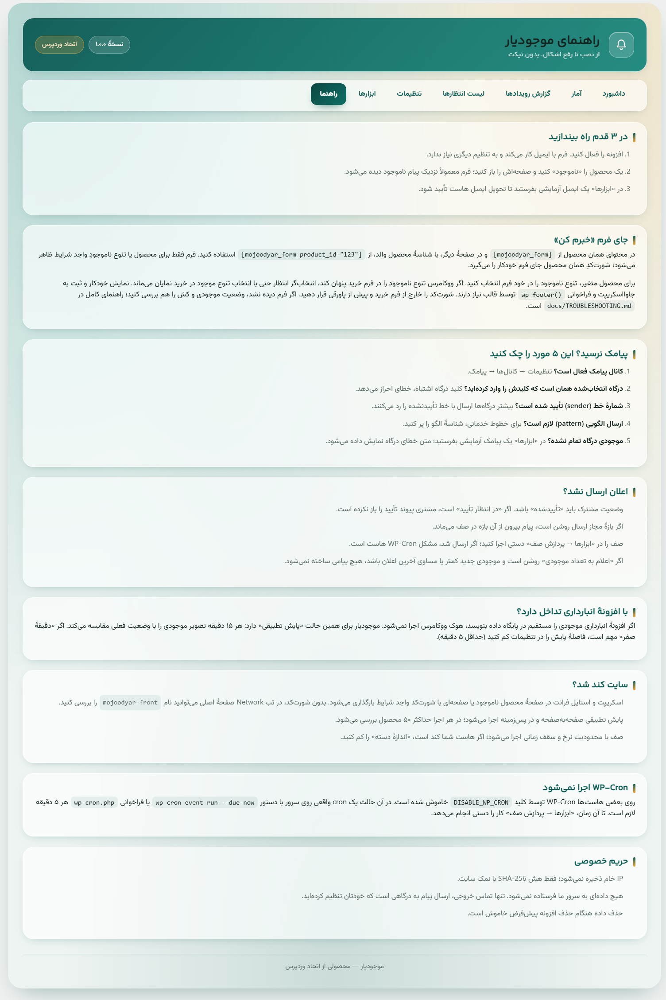

*شکل ۱۰‑۳ — صفحهٔ «راهنما»ی درون‌افزونه‌ای؛ خلاصهٔ سه‌قدم شروع، جای شورت‌کد، پنج بررسی پیامک و سؤال‌های متداول، بدون نیاز به خروج از پیشخوان.*

- دکمهٔ **«خروجی CSV لاگ»** همان فهرست را با هر دو ستون فارسی و خام می‌دهد.
- صفحه‌بندی کامل است: ۲۵ ردیف به‌طور پیش‌فرض (۲۵، ۵۰ یا ۱۰۰ قابل انتخاب) و فیلترها در لینک صفحه‌ها حفظ می‌شوند.
- لاگ‌ها **۹۰ روز** نگه داشته و بعد خودکار پاک می‌شوند. اگر تیکت باز دارید، پیش از پاک‌سازی دستی خروجی بگیرید.

**پیشنهاد.** اگر دنبال «چرا فرم ثبت نمی‌شود» هستید: فیلتر سطح را روی **امنیتی** بگذارید. هر درخواستی که رد شده (نامعتبر، تکراری، کد امنیتی منقضی، محدودیت نرخ) همان‌جا با دلیل فارسی می‌آید. اگر آن فهرست خالی است و مشتری همچنان می‌گوید ثبت نشد، درخواست به افزونه نرسیده است.

## هشدار دربارهٔ ابزارهای پاک‌سازی و عملیات حساس

**خطر.** سه دکمه در این صفحه **بازگشت‌ناپذیر** هستند: «تخلیهٔ صف» (همهٔ پیام‌های در انتظار حذف می‌شود)، «پاک‌سازی رکوردهای قدیمی» (ردیف‌های پایان‌یافته حذف می‌شود) و «پاک کردن لاگ‌ها» در صفحهٔ گزارش رویدادها. پیش از زدن هر یک، اگر به سابقه نیاز دارید خروجی CSV بگیرید. هیچ‌کدام پشتیبان خودکار نمی‌گیرند.

| دکمه | بازگشت‌پذیر؟ | پیش از زدن چه کنید |
| --- | --- | --- |
| تخلیهٔ صف | نه | مطمئن شوید پیام‌های در انتظار را نمی‌خواهید؛ در غیر این صورت صبر کنید تا ارسال شوند. |
| پاک‌سازی رکوردهای قدیمی | نه | از لیست انتظارها خروجی CSV بگیرید. |
| پاک کردن لاگ‌ها | نه | اگر تیکت باز دارید، ابتدا «خروجی CSV لاگ» را بگیرید. |
| بازسازی تصویر موجودی | بله، ولی مرجع زمان عوض می‌شود | بدانید که پس از آن، افزایش موجودی تنها لزوماً اعلان نمی‌سازد. |
| ارسال فوری پیام‌های زمان‌بندی‌شده | نه (پیام می‌رود) | مطمئن شوید فرستادن پیام در این ساعت مناسب است. |

# فصل ۱۱ — حریم خصوصی و امنیت

> شماره و ایمیل مشتری دادهٔ شخصی است. این فصل می‌گوید چه چیزی ذخیره می‌شود، چقدر می‌ماند و شما چه مسئولیتی دارید.

*داده‌های جمع‌آوری‌شده، مدت نگهداری، حذف هنگام حذف افزونه و نکات امنیتی درگاه و API.*

این فصل می‌گوید موجودیار چه اطلاعاتی جمع می‌کند، کجا نگه می‌دارد، چقدر می‌ماند و شما به‌عنوان مدیر فروشگاه چه مسئولیتی دارید. برای فروشگاه ایرانی که با شماره و ایمیل مشتری کار می‌کند، این فصل را حتماً بخوانید.

## اطلاعاتی که افزونه جمع‌آوری می‌کند

| داده | کجا ذخیره می‌شود | چرا |
| --- | --- | --- |
| نام و نام خانوادگی | جدول لیست انتظار، ستون full_name | خطاب کردن مشتری در پیام، تشخیص ردیف‌ها، پیگیری تلفنی. |
| شمارهٔ موبایل | همان جدول، ستون phone (نرمال‌شده به 09xxxxxxxxx) | ارسال پیامک اعلان. |
| ایمیل | همان جدول، ستون email | ارسال ایمیل اعلان و پیوند لغو. |
| شناسهٔ محصول و تنوع | همان جدول | تشخیص اینکه برای کدام کالا خبر بدهیم. |
| وضعیت و زمان‌ها | همان جدول | مدیریت چرخهٔ عمر درخواست. |
| هش IP | ستون ip_hash و جدول لاگ‌ها | محدودیت نرخ و تشخیص سوءاستفاده، بدون ذخیرهٔ IP خام. |
| شناسهٔ کاربر وردپرس | ستون user_id، وقتی مشتری وارد حساب باشد | پیش‌پر کردن فرم و نسبت دادن ردیف به حساب. |

**نکته.** **IP خام هرگز ذخیره نمی‌شود.** فقط یک هَش SHA-256 با نمک سایت نگه داشته می‌شود. این هش برای محدودیت نرخ و تشخیص سوءاستفاده کافی است، اما ناشناس‌سازی کامل نیست؛ فضای IPv4 کوچک است و با حملهٔ دیکشنری ممکن است بازسازی شود. این محدودیت را عمداً پنهان نکرده‌ایم.

| داده | در این نسخه |
| --- | --- |
| ارسال داده به سرور سازنده | انجام نمی‌شود. تنها تماس خروجی، به درگاه پیامکی است که خودتان تنظیم می‌کنید. |
| آمار بازدید یا ردیابی رفتار | جمع‌آوری نمی‌شود. |
| تبلیغات یا اسکریپت شخص ثالث | بارگذاری نمی‌شود. |
| دسترسی به داده از سوی سازنده | وجود ندارد؛ افزونه کلید لایسنس و اتصال اجباری ندارد. |

## نحوهٔ استفاده و نگهداری اطلاعات

| داده | مدت نگهداری | چه چیزی آن را پاک می‌کند |
| --- | --- | --- |
| ردیف‌های لیست انتظار (پایان‌یافته) | پیش‌فرض ۱۸۰ روز از زمان ثبت دورهٔ جاری | پاک‌سازی زمان‌بندی‌شده (وابسته به WP-Cron) یا ابزار «پاک‌سازی رکوردهای قدیمی». |
| لاگ رویدادها | ۹۰ روز | پاک‌سازی خودکار روزانه یا دکمهٔ «پاک کردن لاگ‌ها». |
| ردیف‌های فعال (تأییدشده) | تا زمانی که مشتری لغو کند یا شما حذف کنید | لغو اشتراک، حذف ردیف، یا حذف داده هنگام حذف افزونه. |
| تنظیمات افزونه | تا زمان حذف داده | گزینهٔ «حذف داده هنگام حذف افزونه». |

**هشدار.** مدت نگهداری، **تضمین زمان اجرا** نیست. پاک‌سازی به اجرای WP-Cron وابسته است. اگر سایت بازدید کمی دارد یا `DISABLE_WP_CRON` روشن است و کرون واقعی سرور تنظیم نشده، پاک‌سازی دیرتر اجرا می‌شود.

## تنظیم حذف اطلاعات هنگام حذف افزونه

**گام ۱ — گزینه را پیدا کنید** موجودیار ← تنظیمات ← بخش «حریم خصوصی و پیشرفته» ← «حذف داده هنگام حذف افزونه».

**گام ۲ — روشن و ذخیره کنید** تیک **فعال** را بزنید و «ذخیرهٔ تنظیمات» را بزنید.

**گام ۳ — بعد افزونه را حذف کنید** افزونه‌ها ← غیرفعال کردن ← حذف. با روشن بودن گزینه، همهٔ جدول‌ها و تنظیمات پاک می‌شوند.

**خطر.** برعکسش هم درست است: اگر گزینه **خاموش** باشد (پیش‌فرض)، حذف افزونه داده‌ها را پاک نمی‌کند و جدول‌های موجودیار در پایگاه‌داده باقی می‌مانند. اگر هدف شما پاک‌سازی کامل است، اول گزینه را روشن کنید.

## نکات امنیتی مربوط به API و پیامک

- **کلیدها را فقط در تنظیمات افزونه نگه دارید.** رمز درگاه و توکن API در فیلدهای رمزدار ذخیره می‌شوند و هنگام نمایش، مقدارشان تکرار نمی‌شود.
- **حداقل دسترسی را بدهید.** فقط نقش‌هایی که واقعاً به لیست انتظار نیاز دارند باید قابلیت مدیریت موجودیار را داشته باشند.
- **درگاه عمومی REST فقط https.** نشانی‌های محلی، خصوصی و آی‌پی رد می‌شوند تا افزونه به سرویس‌های داخلی سرور وصل نشود.
- **کد امنیتی فرم (nonce) و محدودیت نرخ فعال است.** سقف پیش‌فرض ۵ درخواست در ساعت برای هر هَش IP است؛ درخواست بیشتر با خطای ۴۲۹ رد می‌شود.
- **شماره و ایمیل در لاگ پوشانده می‌شوند.** در جدول لیست انتظار هم ستون مخاطب پوشانده است؛ فقط خروجی CSV کامل است.
- **پشتیبان‌گیری را جدی بگیرید.** جدول‌های موجودیار دادهٔ شخصی واقعی دارند؛ بدون پشتیبان، بازگرداندن آن‌ها ممکن نیست.

**محدودیت واقعی.** محدودیت‌های شناخته‌شدهٔ این نسخه: محدودیت نرخ بر پایهٔ هَش IP است و پشت پروکسی مشترک ممکن است چند مشتری یک هش داشته باشند؛ توکن تأیید/لغو یک‌بارمصرف طراحی نشده و پس از استفاده در پایگاه‌داده می‌ماند؛ و محافظت SSRF رشتهٔ نشانی را بررسی می‌کند، نه آی‌پی نهایی مقصد.

## مسئولیت مدیر فروشگاه

موجودیار ابزار است؛ مسئولیت قانونی و اخلاقی داده‌های مشتری با شماست. سه کار حداقلی:

- **به مشتری بگویید چه چیزی جمع می‌کنید.** متن توضیح فرم و متن رضایت را طوری بنویسید که مشخص باشد شماره یا ایمیل برای «اعلان بازگشت موجودی» استفاده می‌شود. اگر چک‌باکس رضایت را روشن می‌کنید، لینک سیاست حریم خصوصی را هم بگذارید.
- **راه خروج بدهید.** پیوند لغو اشتراک را از متن پیام‌ها حذف نکنید. در ایمیل به‌طور پیش‌فرض وجود دارد؛ در پیامک به متن یا الگوی انتخابی شما بستگی دارد.
- **دسترسی را محدود و پشتیبان را امن نگه دارید.** خروجی CSV و پشتیبان پایگاه‌داده شامل شماره و ایمیل است؛ آن‌ها را در جای عمومی نگه ندارید.

# فصل ۱۲ — عیب‌یابی و پرسش‌های متداول

> ده مشکل رایج با یک ساختار ثابت: شرح، علت‌های محتمل، روش تشخیص، راه‌حل مرحله‌به‌مرحله و جلوگیری از تکرار.

*اگر همین حالا مشکلی دارید، از فهرست زیر مورد نزدیک را پیدا کنید.*

هر مشکل را با یک ساختار ثابت بررسی می‌کنیم: شرح، علت‌های محتمل، روش تشخیص، راه‌حل مرحله‌به‌مرحله و راه جلوگیری از تکرار.

**پیشنهاد.** پیش از هر چیز: موجودیار ← ابزارها. دو دکمهٔ «اجرای فوری پایش» و «پردازش صف» در همان صفحه نتیجهٔ عددی می‌دهند و در بیشتر موارد علت را همان‌جا نشان می‌دهند.

## ۱) فرم نمایش داده نمی‌شود

| بخش | توضیح |
| --- | --- |
| شرح مشکل | صفحهٔ محصول ناموجود باز می‌شود ولی فرم «خبرم کن» دیده نمی‌شود. |
| علت‌های محتمل | محصول واقعاً ناموجود نیست یا منتشر نشده؛ تنوع واجد شرایط ندارد؛ کش صفحه؛ قالب wp_footer() را صدا نمی‌زند؛ خطای جاوااسکریپت. |

**روش تشخیص** — به همین ترتیب:

- ووکامرس و موجودیار فعال باشند؛ محصول **منتشرشده** و قابل دسترس باشد و وضعیتش «در انبار نیست» باشد. پیش‌سفارش معمولاً موجود محسوب می‌شود.
- برای محصول متغیر، دست‌کم یک تنوع ناموجود، منتشرشده، فعال و قابل‌نمایش لازم است. تنوع بدون قیمت معمولاً در سیاست پیش‌فرض ووکامرس نامرئی است.
- پس از جایگزینی فایل افزونه یا تغییر تنظیمات، کش صفحه، افزونهٔ کش، CDN و کش مرورگر را پاک کنید و صفحه را تازه کنید.
- در **View Source** صفحه دنبال `mjy-form` و `mojoodyar-front-js` بگردید:
- اگر هر دو **هستند** ولی فرم در جای مناسب نیست، قالب جایگاه استاندارد را تولید نکرده است؛ از شورت‌کد استفاده کنید.
- اگر **نیستند**، شرط‌های موجودی/انتشار برقرار نیست یا کش پاسخ قدیمی می‌دهد.

**راه‌حل:** شورت‌کد را در محتوای همان محصول بگذارید:

```text
[mojoodyar_form]
```

یا در صفحهٔ دیگر با شناسهٔ محصول والد:

```text
[mojoodyar_form product_id="123"]
```

**جلوگیری از تکرار:** پس از هر تغییر موجودی محصولات کلیدی، کش را پاک کنید؛ برای محصولات مهم شورت‌کد صریح بگذارید تا به جایگاه قالب وابسته نباشید.

**محدودیت واقعی.** ثبت فرم بدون جاوااسکریپت انجام نمی‌شود. اگر اسکریپت بار نشود، دکمه غیرفعال می‌ماند. این محدودیت طراحی است، نه خطا.

## ۲) پیامک ارسال نمی‌شود

| بخش | توضیح |
| --- | --- |
| شرح مشکل | مشتری ثبت کرده و موجودی برگشته، ولی پیامکی نمی‌رسد. |
| علت‌های محتمل | سوئیچ پیامک خاموش؛ درگاه ناقص؛ اعتبار تمام‌شده؛ شمارهٔ خط یا الگو تأیید نشده؛ پیام در صف مانده؛ مشترک در وضعیت در انتظار تأیید. |

**روش تشخیص و راه‌حل:** پنج چیز را به همین ترتیب بررسی کنید:

- تنظیمات ← کانال‌ها ← «پیامک ← فعال» تیک خورده باشد.
- همان درگاهی که کلیدش را وارد کرده‌اید، در فهرست «درگاه پیامک» انتخاب شده باشد.
- شمارهٔ خط (sender) در پنل درگاه تأیید شده باشد.
- اگر خط خدماتی است، شناسهٔ الگو پر و متن تأییدشده درست باشد (فصل ۶).
- اعتبار حساب درگاه را در «ابزارها ← ارسال پیامک آزمایشی» بسنجید؛ متن خطای واقعی همان‌جا نمایش داده می‌شود.

سپس وضعیت صف را ببینید: ابزارها ← «پردازش صف». اگر شمارندهٔ «در صف» بالا بود و ارسال نشد، مشکل کرون است (بند ۴). اگر مشترک «در انتظار تأیید» بود، پیام عمداً نرفته است.

**جلوگیری از تکرار:** یک پیامک آزمایشی و یک «پردازش صف» را به فهرست بررسی ماهانه اضافه کنید؛ اعتبار درگاه را پیش از کمپین‌ها چک کنید.

## ۳) ایمیل ارسال نمی‌شود

| بخش | توضیح |
| --- | --- |
| شرح مشکل | اعلان ایمیل به مشتری نمی‌رسد یا به هرزنامه می‌رود. |
| علت‌های محتمل | wp_mail روی هاست کار نمی‌کند؛ SPF/DKIM تنظیم نشده؛ فرستنده معتبر نیست؛ صف اجرا نشده. |

**تشخیص:** ابزارها ← «ارسال ایمیل آزمایشی». اگر همان هم نرسید، مشکل هاست است، نه افزونه. برای فرد فنی:

```text
wp eval 'var_dump( wp_mail( "you@example.com", "test", "body" ) );'
```

**راه‌حل روی لوکال‌هاست/XAMPP:** PHP معمولاً با `sendmail_path` خالی و

`SMTP=localhost` کامپایل شده و هیچ سرور پستی روی پورت ۲۵ گوش نمی‌دهد. سه راه:

- **Mailpit** (سبک، پیشنهادی برای آزمون): در php.ini مقدار `SMTP = 127.0.0.1` و `smtp_port = 1025` را بگذارید؛ همهٔ ایمیل‌ها در رابط وب
`http://localhost:8025` دیده می‌شوند. + یک **افزونهٔ SMTP** (WP Mail SMTP یا FluentSMTP) با SMTP محلی. نام افزونهٔ فعال در صفحهٔ ابزارها نمایش داده می‌شود. + یک **حساب SMTP واقعی** در همان افزونهٔ SMTP.

**جلوگیری:** برای محیط تولید، همیشه SMTP معتبر با SPF و DKIM تنظیم کنید.

## ۴) صف پردازش نمی‌شود

| بخش | توضیح |
| --- | --- |
| شرح مشکل | پیام در صف می‌ماند و خودش ارسال نمی‌شود؛ با دکمهٔ دستی ارسال می‌شود. |
| علت‌های محتمل | WP-Cron اجرا نمی‌شود (بازدید کم یا DISABLE_WP_CRON)؛ قفل اجرا؛ ردیف رهاشده؛ بازهٔ مجاز ارسال. |

**تشخیص:**

- ابزارها ← «پردازش صف». اگر پیام «قفل» داد، «آزادکردن صفِ گیرکرده» را بزنید.
- زمان‌بندی‌ها را ببینید: اگر `DISABLE_WP_CRON` روشن است، باید کرون واقعی سرور تنظیم شده باشد.

```text
wp cron event list
*/5 * * * * cd /path/to/wp && wp cron event run --due-now >/dev/null 2>&1
```

دو رویداد را باید ببینید: `mojoodyar_process_queue` (هر ۵ دقیقه) و

`mojoodyar_reconcile_stock` (هر ۵ دقیقه، با آستانهٔ داخلی ۱۵ دقیقه) و

`mojoodyar_prune_records` (روزانه).

**راه‌حل:** یا بازدید سایت را طبیعی نگه دارید، یا کرون واقعی سرور را با فرمان بالا تنظیم کنید. برای فوریت، «پردازش صف» را دستی بزنید.

**جلوگیری:** کرون سرور را از ابتدا تنظیم کنید؛ برای سایت‌های کم‌بازدید این تنها راه قابل اتکاست.

## ۵) اعلان پس از افزایش موجودی انجام نمی‌شود

| بخش | توضیح |
| --- | --- |
| شرح مشکل | موجودی را زیاد کرده‌اید ولی اعلانی ساخته نشده است. |
| علت‌های محتمل | وضعیت از ناموجود به موجود تغییر نکرده؛ موجودی مدیریت‌نشده؛ «اعلام به تعداد موجودی» جلوی ارسال را گرفته؛ مشترک تأییدشده نیست. |

**تشخیص:** سریع‌ترین راه، ابزارها ← «چرا برای این محصول پیامی نرفت؟» با شناسهٔ محصول است. تعداد مشترک تأییدشده، تصویر موجودی و وضعیت صف همان‌جا دیده می‌شود.

- آیا مشترکی در وضعیت **تأییدشده** هست؟ اگر «تأییدشده» صفر بود، همان علت است.
- آیا گذار «ناموجود ← موجود» رخ داده است؟ **صرف افزایش تعداد، بدون گذار از ناموجود به موجود، الزاماً اعلان تازه نمی‌سازد.**
- آیا «اعلام به تعداد موجودی» روشن است و موجودی جدید از آخرین موجودی اعلان‌شده بیشتر نیست؟ در این حالت عمداً پیامی ساخته نمی‌شود؛ ردیف مربوطه در گزارش رویدادها دیده می‌شود.

**راه‌حل:** اگر تغییر موجودی از مسیری آمده که هوک نمی‌دهد (اکسل، ERP، SQL)، ابزارها ← «اجرای فوری پایش» را بزنید و نتیجه را در گزارش رویدادها ببینید. سپس «پردازش صف».

**جلوگیری:** موجودی را از پنل ووکامرس تغییر دهید تا هوک اجرا شود؛ برای مسیرهای بیرونی، پایش تطبیقی را فعال نگه دارید.

## ۶) شورت‌کد کار نمی‌کند

| بخش | توضیح |
| --- | --- |
| شرح مشکل | شورت‌کد به‌صورت متن نمایش داده می‌شود یا خروجی خالی دارد. |
| علت‌های محتمل | شورت‌کد در بلوک متن ساده است؛ محصول موجود است؛ شناسه غلط است؛ شورت‌کد داخل فرم دیگری است. |

**تشخیص و راه‌حل:**

- شورت‌کد باید در **بلوک شورت‌کد** (یا ویجت شورت‌کد صفحه‌ساز) باشد، نه در بلوک پاراگراف ساده.
- اگر متن شورت‌کد **چاپ شد**، یعنی وردپرس آن را پردازش نکرده است؛ بلوک را عوض کنید.
- اگر **خروجی خالی** است، یعنی شرط‌ها برقرار نیست: محصول موجود است، منتشر نشده، یا شناسه غلط است. خروجی خالی برای محصول موجود، رفتار درست است.
- شناسه را از فهرست محصولات بردارید؛ برای محصول متغیر **شناسهٔ والد** را بنویسید، نه شناسهٔ تنوع.
- شورت‌کد را از داخل هر `<form>` دیگر بیرون بیاورید.

## ۷) فرم در محصولات متغیر رفتار مورد انتظار را ندارد

| بخش | توضیح |
| --- | --- |
| شرح مشکل | در محصول متغیر، فرم نمایش داده نمی‌شود یا انتخاب‌گر تنوع رفتار عجیب دارد. |
| علت‌های محتمل | همهٔ تنوع‌ها موجودند؛ تنوع ناموجود خصوصی/غیرفعال/نامرئی است؛ تنظیم «پنهان‌کردن محصولات ناموجود» ووکامرس؛ کش. |

**تشخیص و راه‌حل:**

- فرم فقط وقتی ساخته می‌شود که دست‌کم یک تنوع **ناموجود، منتشرشده، فعال و قابل‌نمایش** وجود داشته باشد. تنوع خصوصی یا غیرفعال طبق سیاست ووکامرس نمایش داده نمی‌شود — و افزونه این سیاست را تغییر نمی‌دهد.
- در فرم، انتخاب‌گر مستقل «تنوع ناموجود» هست. اگر فروشگاه «پنهان‌کردن محصولات ناموجود» را روشن کرده باشد، تنوع ناموجود در انتخاب‌گر **انتظار** همچنان قابل انتخاب است، ولی گزینه‌های **خرید** عوض نمی‌شوند.
- اگر همهٔ تنوع‌های انتظار در فرم خرید قابل انتخاب باشند، انتخاب تنوع موجود، فرم انتظار را مخفی می‌کند. این رفتار عمدی است.

**پیشنهاد.** اگر گزینه‌ای تازه موجود یا ناموجود شده و رفتار عجیب شد، صفحه و کش را تازه کنید. کش صفحه بیشتر از هر چیز دیگری در محصولات متغیر دردسر می‌سازد.

## ۸) زمان‌بندی خودکار اجرا نمی‌شود

| بخش | توضیح |
| --- | --- |
| شرح مشکل | هیچ اعلانی خودکار نمی‌رود، ولی با دکمهٔ دستی همه‌چیز کار می‌کند. |
| علت‌های محتمل | WP-Cron غیرفعال است یا سایت بازدید ندارد؛ زمان‌بندی‌ها حذف شده‌اند؛ ساعت سرور نادرست است. |

**تشخیص:**

```text
wp cron event list
wp option get timezone_string
```

اگر رویدادهای موجودیار در فهرست نیستند، یک بار صفحهٔ افزونه‌ها را باز کنید؛ افزونه زمان‌بندی‌های گم‌شده را خودش دوباره ثبت می‌کند. اگر `DISABLE_WP_CRON` روشن است، WP-Cron اجرا نمی‌شود و باید کرون واقعی سرور تنظیم شود.

**راه‌حل:** کرون سرور را تنظیم کنید:

```text
*/5 * * * * cd /path/to/wp && wp cron event run --due-now >/dev/null 2>&1
```

**جلوگیری:** ساعت سرور و منطقهٔ زمانی وردپرس باید درست باشند؛ ستون «زمان اجرای بعدی» صف به وقت UTC ذخیره می‌شود.

## ۹) مشکلات متداول دیگر

| نشانه | علت | راه‌حل |
| --- | --- | --- |
| پیام‌ها تکرار می‌شوند | دو افزونهٔ اعلان روی سایت، یا تولید دوبارهٔ ردیف صف برای یک رویداد. | افزونهٔ دوم را غیرفعال کنید؛ ستون event_key را بررسی کنید. |
| خطای «جدول ساخته نشد» یا موتور InnoDB نیست | محدودیت dbDelta یا موتور پیش‌فرض هاست. | وضعیت جدول را با SHOW TABLE STATUS ببینید و در صورت نیاز ALTER TABLE … ENGINE=InnoDB بزنید. |
| حافظه تمام شد یا timeout در فروشگاه بزرگ | دستهٔ بزرگ صف یا پیمایش زیاد پایش. | «اندازهٔ دسته» را از ۵۰ به ۲۵ کم کنید. |
| CSV در اکسل به‌هم‌ریخته باز می‌شود | اکسل نسخهٔ قدیمی BOM را روی csv نادیده می‌گیرد. | از Data ← From Text/CSV و انتخاب UTF-8 استفاده کنید. |
| تاریخ‌ها شمسی نیستند | صفحه از نسخهٔ کش‌شدهٔ قدیمی می‌آید. | کش را پاک کنید؛ خروجی CSV عمداً میلادی است. |
| پس از حذف افزونه داده‌ها ماندند | گزینهٔ حذف داده خاموش بوده است. | گزینه را روشن کنید، ذخیره کنید، سپس افزونه را حذف کنید. |
| درگاه InvalidData می‌دهد | تعداد متغیر، طول مقدار یا متن الگو با الگوی تأییدشده یکی نیست. | فصل ۶ و بخش ۱۲ همین فصل را بخوانید. |
| صفحهٔ پیگیری تلفنی در منو نیست | این صفحه عمداً از منو پنهان است. | از دکمهٔ «پیگیری تلفنی» در ستون «تماس» استفاده کنید. |

## ۱۰) خطای InvalidData در درگاه پیامک

| بخش | توضیح |
| --- | --- |
| شرح مشکل | درگاه پیام را با InvalidData رد می‌کند. |
| علت‌های محتمل | شمارش یا ترتیب متغیرها؛ طول یک مقدار؛ ناسازگاری متن الگو با الگوی تأییدشده؛ خط یا حساب. |

**تشخیص:** گزارش رویدادها شکل درخواست را نشان می‌دهد، بدون خود مقدارها:

```text
sms|failed|attempt=3|err=InvalidData (pattern|bodyId=98765|values=2,lengths=4,30)
```

- `values=2` یعنی دو مقدار فرستادیم. متن تأییدشدهٔ الگو باید **دقیقاً** همین تعداد متغیر داشته باشد؛ اگر الگو یک متغیر دارد و سایت دو می‌فرستد، همین خطا برمی‌گردد.
- `lengths` طول هر مقدار است. نام مشتری و نام محصول خودکار کوتاه می‌شوند؛
**نشانی محصول کوتاه نمی‌شود**، چون نشانی نصفه بی‌فایده است. اگر عددی بزرگ دیدید و آن مقدار نشانی محصول است، افزونه پیش از تماس با درگاه متوقف می‌شود و می‌گوید کدام متغیر چند کاراکتر است.

**راه‌حل، به ترتیب سودمندی:**

- **نشانی کوتاه محصول** را انتخاب کنید (تنظیمات ← «نشانی محصول در پیامک» را روی «نشانی کوتاه محصول» بگذارید). مقدار به شکل `https://دامنه/?p=1234` در می‌آید.
- اگر دامنهٔ کوتاهی دارید که به فروشگاه اشاره می‌کند، در فیلد «دامنهٔ کوتاه» بگذارید.
- `{2}` را از الگو **بردارید** و نشانی را به‌صورت متن ثابت داخل الگوی پنل بگذارید: آن‌وقت لینک متغیر نیست و محدودیت طولی ندارد.
- اگر اپراتور شما واقعاً مقدار بلندتری قبول می‌کند، «سقف کاراکتر هر متغیر» را بالا ببرید (پیش‌فرض ۲۵ و حداکثر ۷۰) و بعد «آزمون ارسال الگو» را اجرا کنید.

**جلوگیری:** متن تأییدشده را عیناً از پنل کپی کنید و در تنظیمات بگذارید تا ترتیب و تعداد متغیرها یکی شود؛ پس از هر تغییر الگو، «آزمون ارسال الگو» را بزنید.

## ۱۱) چه اطلاعاتی برای پشتیبانی بفرستیم

- نسخهٔ PHP، وردپرس و ووکامرس (از صفحهٔ ابزارها).
- خروجی «اجرای فوری پایش» و «پردازش صف» (اعداد، بدون دادهٔ شخصی).
- آخرین ۱۰ خط از `wp-content/debug.log` اگر `WP_DEBUG` روشن است.
- اگر مشکل ظاهری است، نشانی صفحهٔ محصول، شناسه، وضعیت موجودی و نام/نسخهٔ قالب.
- خطاهای Console و Network مرورگر، اگر فرم ثبت نمی‌شود.

**خطر.** **هرگز** رمز درگاه پیامک، توکن API یا لیست ایمیل و موبایل مشتریان را در تیکت عمومی، گفت‌وگوی گروهی یا اسکرین‌شات نگذارید. برای گزارش‌های عددی از خروجی CSV بدون ستون‌های مخاطب استفاده کنید.

## ۱۲) پرسش‌های متداول

| پرسش | پاسخ |
| --- | --- |
| آیا بدون ووکامرس کار می‌کند؟ | نه. برای فرم روی صفحهٔ محصول و تشخیص موجودی، ووکامرس لازم است. |
| آیا داده‌ای به سرور شما می‌فرستد؟ | نه. تنها تماس خروجی، به درگاه پیامکی است که خودتان تنظیم می‌کنید. |
| با حذف افزونه داده‌ها پاک می‌شوند؟ | نه، مگر گزینهٔ حذف داده هنگام حذف افزونه را روشن کرده باشید. |
| می‌توانم فقط پیامک داشته باشم؟ | بله. کانال‌ها ← پیامک را روشن کنید، درگاه را کامل کنید و اولویت کانال را روی پیامک بگذارید. حداقل یک کانال باید فعال بماند. |
| می‌توانم فرم را در جای دلخواه بگذارم؟ | بله، با شورت‌کد. محصول باید ناموجود و قابل نمایش باشد. |
| آیا با HPOS کار می‌کند؟ | کد به جدول posts وابسته نیست و از API رسمی ووکامرس استفاده می‌کند، اما این ادعا روی نصب واقعی HPOS آزمون نشده است. |
| چند سایت روی یک نصب (network)؟ | روی نصب شبکه آزمون نشده است. هر سایت جدول‌های خودش را با پیشوند خودش می‌سازد. |
| چندزبانه کار می‌کند؟ | متن پنل مستقیماً فارسی است. ترجمهٔ کامل رابط در این نسخه ارائه نشده و فقط چند رشتهٔ محدود از فایل ترجمه می‌گذرد. |
| آیا اپراتور پیامک من پشتیبانی می‌شود؟ | اگر یکی از سه درگاه اختصاصی یا سرویس سازگار با درگاه عمومی REST باشد، بله. در غیر این صورت باید درگاه عمومی را با قالب JSON آن سرویس تنظیم کنید. |
| حداکثر چند منتظر پشتیبانی می‌شود؟ | محدودیت سختی در کد نیست؛ آزمون بار با ۱۰٬۰۰۰ منتظر و ۵ واحد موجودی انجام شده است. عملکرد روی MySQL واقعی با حجم بالا اندازه‌گیری نشده است. |

# واژه‌نامه، منابع و پایان

## واژه‌نامهٔ اصطلاح‌ها

| اصطلاح | یعنی چه | کجای راهنما |
| --- | --- | --- |
| هوک (hook) | نقطه‌ای در وردپرس که کد افزونه‌ها می‌تواند در آن اجرا شود. | ۲، ۴ |
| کرون (Cron / WP-Cron) | زمان‌بند وردپرس که کارهای دوره‌ای را در بازدیدهای سایت اجرا می‌کند. | ۲، ۴، ۱۲ |
| صف (Queue) | فهرست پیام‌هایی که باید ارسال شوند، با تعداد تلاش و زمان هر کدام. | ۴، ۱۰ |
| قفل (Lock) | علامتی که جلوگیری می‌کند دو اجرای همزمان، یک صف را با هم پردازش کنند. | ۱۰ |
| تصویر موجودی (Snapshot) | عکسی از وضعیت انبار که مبنای تشخیص «برگشت موجودی» است. | ۱، ۱۰ |
| پایش تطبیقی | مقایسهٔ دوره‌ای وضعیت فعلی انبار با تصویر قبلی، برای محصولاتی که هوک نمی‌دهند. | ۴، ۱۰ |
| گذار (Transition) | تغییر وضعیت از «ناموجود» به «موجود»؛ همان چیزی که اعلان را فعال می‌کند. | ۱، ۱۲ |
| الگو (Pattern) | متن رسمی و تأییدشدهٔ پیامک در پنل اپراتور، با متغیرهای شماره‌دار. | ۶ |
| متغیر (Placeholder) | جای خالی در متن پیام که افزونه با نام مشتری یا محصول پر می‌کند. | ۶ |
| کد امنیتی (Nonce) | کد یک‌بارمصرف فرم برای جلوگیری از درخواست جعلی. | ۳، ۱۱ |
| محدودیت نرخ (Rate Limit) | سقف تعداد درخواست از یک منبع در یک بازهٔ زمانی. | ۳، ۱۱ |
| پوشاندن (Masking) | نمایش بخشی از ایمیل یا شماره به‌جای مقدار کامل. | ۷، ۱۱ |
| HPOS | محل ذخیرهٔ سفارش‌های ووکامرس در جدول‌های اختصاصی، به‌جای جدول posts. | ۱۲ |
| SSRF | حمله‌ای که سرور را مجبور می‌کند به نشانی داخلی خودش درخواست بزند. | ۱۱ |
| REST | رابط مبتنی بر HTTP که فرم و درگاه پیامک با آن کار می‌کنند. | ۳، ۵ |

## منابع این راهنما

این راهنما فقط از منابع واقعی پروژه ساخته شده است. برای هر ادعا، منبع آن این‌ها بود:

| منبع | چه چیزی از آن گرفته شد |
| --- | --- |
| بستهٔ مستندات محصول | تصاویر واقعی رابط کاربری، لوگوی رسمی موجودیار و لوگوی ژاکت؛ همین تصاویر در سند به کار رفته‌اند. |
| کد افزونه (نسخهٔ ۱.۰.۰) | همهٔ نام گزینه‌ها، پیش‌فرض‌ها، متن دکمه‌ها، کدهای رویداد، وضعیت‌ها، درگاه‌ها، شورت‌کدها و مسیرهای منو. |
| مستندات درون بستهٔ افزونه | ساختار داده، سیاست امنیتی، فهرست آزمون‌ها و شمارش فرضیه‌های آزمون. |
| فایل خواندنی و تاریخچهٔ تغییرات | نسخه، سازگاری اعلام‌شده با وردپرس و ووکامرس و PHP. |
| تصاویر واقعی پیشخوان | همهٔ شکل‌های این راهنما؛ از یک نصب نمونه با داده‌های آزمایشی. |

**نکته.** جایی که مستندات و کد اختلاف داشتند، **کد مبنا قرار گرفت**. موردی که در این نسخه دیدیم: متن راهنمای کوتاه درون افزونه از «حالت پیش‌فرض تأیید دومرحله‌ای خاموش» حرف می‌زند و کد هم همان را تأیید می‌کند؛ ولی راهنمای تصویری قدیمی‌تر ممکن است چیز دیگری نشان دهد. مبنای این راهنما، رفتار کد و صفحهٔ تنظیمات فعلی است.

## آنچه در این نسخه آزمون نشده است

| مورد | وضعیت |
| --- | --- |
| PHP ۸.۱ و ۸.۴ | آزمون خودکار فقط روی PHP ۷.۴ و ۸.۳ اجرا شده است. |
| وردپرس ۷ و ووکامرس ۱۱ | نسخه‌های آیندهٔ این افزونه‌ها آزمون نشده‌اند. |
| HPOS در نصب واقعی | کد وابستگی به جدول posts ندارد، اما آزمون روی نصب HPOS انجام نشده است. |
| نصب چندسایتی (Multisite) | آزمون نشده است. |
| تحویل واقعی پیامک و ایمیل | آزمون خودکار به درگاه واقعی وصل نمی‌شود؛ باید با «ارسال آزمایشی» در محیط خودتان بسنجید. |
| همهٔ قالب‌ها و صفحه‌سازها | فقط قالب‌ها و صفحه‌سازهای رایج بررسی شده‌اند؛ قالب شما ممکن است متفاوت باشد. |
| بار واقعی MySQL با حجم بالا | آزمون بار با ۱۰٬۰۰۰ منتظر انجام شده، ولی روی MySQL واقعی با رقابت همزمان اندازه‌گیری نشده است. |

## جمع‌بندی

اگر این راهنما را تا اینجا خوانده‌اید، اکنون می‌توانید موجودیار را نصب کنید، فرم را در جای درست بگذارید، پیامک و ایمیل را تنظیم و آزمون کنید، درخواست‌ها را مدیریت و پیگیری تلفنی را ثبت کنید، با آمار تصمیم بگیرید و بیشتر خطاهای رایج را خودتان پیدا کنید. اگر جایی به بن‌بست خوردید، فصل ۱۲ و صفحهٔ ابزارها را اول ببینید؛ در بیشتر موارد پاسخ همان‌جاست.

موجودیار | Mojoodyar — راهنمای کاربری، نسخهٔ ۱.۰.۰

محصول: موجودیار | Mojoodyar · سازنده: اتحاد وردپرس · این راهنما برای انتشار در ژاکت تهیه شده است. تصاویر از یک فروشگاه نمونه گرفته شده‌اند و داده‌های واقعی مشتریان نیستند.