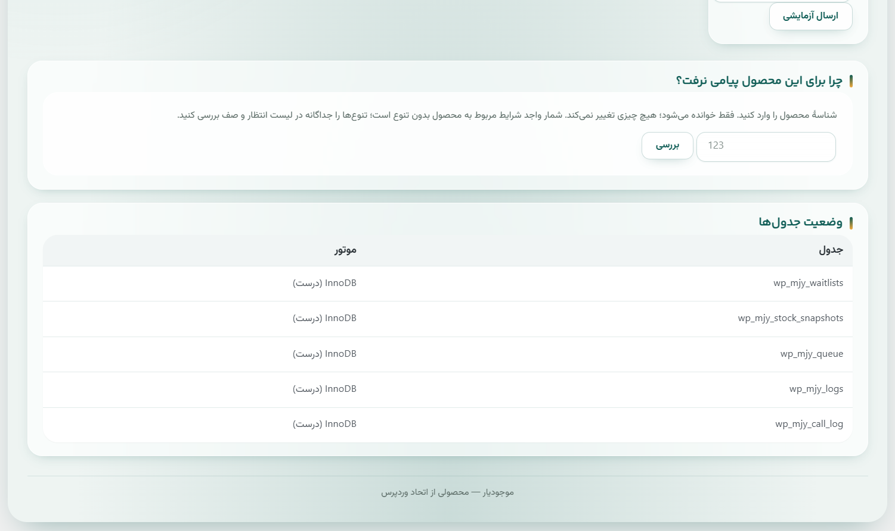

این فایل، راهنمای *نصب، فعال‌سازی، دسترسی و بروزرسانی* افزونهٔ موجودیار است و همراه بستهٔ خرید تحویل داده می‌شود. اگر به‌دنبال آموزش کار با خود افزونه — تنظیم پیامک و ایمیل، ساخت فرم، مدیریت لیست انتظار، آمار و عیب‌یابی — هستید، آن توضیحات در فایل جداگانهٔ *راهنمای جامع کاربری* آمده است.

| در این فایل هست | در این فایل نیست |
| --- | --- |
| نصب از پیشخوان وردپرس و نصب دستی با FileZilla | آموزش کار با بخش‌های داخلی افزونه |
| فعال‌سازی، دسترسی به منو و تنظیم زمان‌بندی پس از نصب | تنظیم درگاه پیامک و متن پیام‌ها |
| سه روش بروزرسانی و بازگشت به نسخهٔ قبلی | مدیریت لیست انتظار و گزارش‌ها |

## دو فایل راهنما، دو کار متفاوت

بستهٔ موجودیار دو سند دارد و هر کدام کار خودش را می‌کند. اشتباه گرفتن‌شان باعث می‌شود وقت زیادی دنبال چیزی بگردید که در آن فایل نیست.

| فایل | محل | برای چه |
| --- | --- | --- |
| help.pdf — همین فایل | روت بستهٔ خرید | نصب، فعال‌سازی، دسترسی و بروزرسانی افزونه؛ همان چیزی که پیش از شروع کار لازم است. |
| راهنمای جامع کاربری | پوشهٔ مستندات بسته | آموزش کامل ۱۲ بخش افزونه، تنظیمات، پیامک و ایمیل، آمار و عیب‌یابی روزمره. |

**نکته.** اگر فقط یک ساعت وقت دارید: اول همین فایل را تا آخر بخوانید (حدود ۱۵ دقیقه)، بعد بخش «شروع سریع» راهنمای جامع را باز کنید. ترتیب برعکس، معمولاً به خطای نصب و پیام «فرم نمایش داده نمی‌شود» می‌رسد.

# فصل ۱ — محتوای بسته و پیش‌نیازها

> پیش از نصب باید بدانید در بستهٔ خرید چه چیزی هست، چه نسخه‌هایی لازم است و روی سرور چه چیزی باید فعال باشد.

*فهرست فایل‌ها، نسخه‌های پشتیبانی‌شده و چهار بررسی سریع پیش از نصب.*

## محتوای بستهٔ خرید

پس از خرید و دانلود از ژاکت، فایل ZIP را از حالت فشرده خارج کنید. ساختار بسته به این شکل است:

```text
Mojoodyar-Documentation/
├── 01-Plugin-ZIP/
│   └── Mojoodyar.zip              ← فایل نصب افزونه
├── 02-Screenshots/                ← تصاویر محیط افزونه
├── 03-Logos/                      ← لوگوی موجودیار و ژاکت
├── 04-Help/
│   ├── help.pdf                   ← همین فایل (نصب و بروزرسانی)
│   └── Mojoodyar-User-Guide-FA.pdf ← راهنمای جامع کاربری
└── 05-Docs/                       ← مستندات فنی و گزارش آزمون
```

**هشدار.** فایل نصب، **Mojoodyar.zip** است، نه فایل ZIP اصلی خرید. اگر همان بستهٔ بزرگ را در وردپرس بارگذاری کنید، پیام «فایل بستهٔ افزونه پیدا نشد» می‌گیرید؛ چون ZIP باید یک پوشه با فایل `mojoodyar.php` در ریشهٔ خودش داشته باشد.

## پیش‌نیازها

| مورد | حداقل لازم | توضیح |
| --- | --- | --- |
| وردپرس | ۶٫۴ | نسخهٔ دقیق آزمون‌شده ۶٫۴٫۵ است؛ نسخه‌های پایین‌تر پشتیبانی نمی‌شوند. |
| ووکامرس | ۹٫۰ | بدون ووکامرس، فرم روی سایت نمایش داده نمی‌شود. |
| PHP | ۷٫۴ | کد با PHP ۷٫۴ تا ۸٫۳ سازگار است. PHP ۸٫۴ در این نسخه آزمون نشده است. |
| پایگاه‌داده | MySQL یا MariaDB با موتور InnoDB | پنج جدول با پیشوند `mjy_` ساخته می‌شود. |
| دسترسی هاست | دسترسی FTP یا مدیر فایل | فقط برای روش نصب دستی لازم است. |

**پیشنهاد.** هر دو مورد اول را می‌توانید در پیشخوان ببینید: **پیشخوان** ← **ابزارها** ← **سلامت سایت** ← تب **اطلاعات**. نسخهٔ وردپرس، نسخهٔ PHP و نسخهٔ MySQL همان‌جا نوشته شده است. پیش از نصب همین یک صفحه را نگاه کنید.

## چهار بررسی پیش از نصب

**گام ۱ — ووکامرس فعال است** به **افزونه‌ها** ← **افزونه‌های نصب‌شده** بروید و مطمئن شوید ووکامرس نصب و **فعال** است. اگر ووکامرس غیرفعال باشد، موجودیار نصب می‌شود ولی فرم روی سایت ظاهر نمی‌شود.

**گام ۲ — نسخهٔ PHP و وردپرس کافی است** در همان صفحهٔ سلامت سایت، نسخهٔ PHP باید ۷٫۴ یا بالاتر و وردپرس ۶٫۴ یا بالاتر باشد. اگر PHP پایین‌تر است، پیش از نصب از هاستینگ بخواهید نسخه را بالا ببرد.

**گام ۳ — از سایت پشتیبان دارید** پیش از هر نصب یا بروزرسانی، یک پشتیبان کامل (فایل‌ها + پایگاه‌داده) بگیرید. افزونه جدول می‌سازد و تنظیم می‌نویسد؛ اگر وسط کار چیزی خراب شد، بازگشت بدون پشتیبان ممکن نیست.

**گام ۴ — "به‌روزرسانی خودکار" را برای این افزونه خاموش کنید** تا وقتی بروزرسانی خودکار وردپرس را برای افزونه‌های شخص ثالث روشن نگه داشته‌اید، ممکن است نسخهٔ افزونه بدون اطلاع شما عوض شود. روش خاموش‌کردن آن در فصل ۴ آمده است. این کار اختیاری است، اما برای فروشگاه‌های فعال توصیه می‌شود.

**خطر.** اگر هاست شما محدودیت حجم بارگذاری دارد (معمولاً ۲ تا ۸ مگابایت)، نصب از پیشخوان با پیام «فایل بارگذاری‌شده از حداکثر حجم مجاز بیشتر است» شکست می‌خورد. راه‌حل قطعی، نصب دستی با FileZilla در فصل ۳ است — نه تلاش دوباره.

# فصل ۲ — نصب از پیشخوان وردپرس

> ساده‌ترین روش و مسیر پیشنهادی: پنج گام تا فعال‌سازی، بدون نیاز به دسترسی FTP.

*همین روش را اول امتحان کنید؛ اگر هاست اجازهٔ بارگذاری نداد، به فصل بعد بروید.*

## پنج گام نصب

**گام ۱ — فایل نصب را آماده کنید** فایل **Mojoodyar.zip** را از پوشهٔ `01-Plugin-ZIP` بردارید. آن را از حالت فشرده خارج **نکنید** و اسمش را هم عوض نکنید؛ وردپرس فایل ZIP را می‌خواهد، نه پوشهٔ باز.

**گام ۲ — به صفحهٔ بارگذاری بروید** در پیشخوان وردپرس: **افزونه‌ها** ← **افزودن افزونه** ← دکمهٔ **بارگذاری افزونه** در بالای صفحه.

**گام ۳ — فایل را انتخاب و نصب کنید** دکمهٔ **انتخاب فایل** را بزنید، **Mojoodyar.zip** را انتخاب کنید، سپس **هم‌اکنون نصب کن** را بزنید. صبر کنید تا پیام «نصب افزونه با موفقیت انجام شد» بیاید.

**گام ۴ — افزونه را فعال کنید** پس از پیام موفقیت، دکمهٔ **فعال کردن افزونه** را بزنید. با فعال‌سازی، جدول‌های پایگاه‌داده ساخته می‌شوند، تنظیمات پیش‌فرض نوشته می‌شود و سه زمان‌بندی WP-Cron ثبت می‌گردد.

**گام ۵ — منوی موجودیار را ببینید** در نوار کناری پیشخوان، منوی **موجودیار** با آیکون زنگ (زنگ اعلان) اضافه می‌شود. اگر آن را نمی‌بینید، فصل ۴ را ببینید.

**نکته.** موجودیار کلید لایسنس ندارد، به سرور سازنده وصل نمی‌شود و وابستگی اضافه (Composer، npm، IonCube) نمی‌خواهد. فعال‌سازی، آخرین گام نصب است؛ بعد از آن هیچ «فعال‌سازی آنلاین» یا «ثبت کد خرید» لازم نیست.

## پیام‌هایی که ممکن است ببینید

| پیام | معنی | کار شما |
| --- | --- | --- |
| نصب افزونه با موفقیت انجام شد | همه‌چیز درست است | دکمهٔ «فعال کردن افزونه» را بزنید. |
| فایل بارگذاری‌شده از حداکثر حجم مجاز بیشتر است | محدودیت `upload_max_filesize` هاست | به فصل ۳ بروید و با FileZilla نصب کنید. |
| فایل بستهٔ افزونه پیدا نشد | ZIP اشتباه است یا پوشهٔ تودرتو دارد | فایل `Mojoodyar.zip` را از پوشهٔ `01-Plugin-ZIP` بردارید. |
| این فایل را نمی‌توان نصب کرد: فایل PHP معتبر نیست | فایل ناقص دانلود شده است | بسته را دوباره از ژاکت دانلود کنید و ZIP را دوباره بسازید. |

# فصل ۳ — نصب دستی با FileZilla

> وقتی هاست اجازهٔ بارگذاری از پیشخوان نمی‌دهد: انتقال پوشهٔ افزونه با FTP و فعال‌سازی از پیشخوان.

*مسیر درست روی سرور، تنظیم FileZilla و پنج گام انتقال — همان روشی که برای هر افزونهٔ وردپرس کار می‌کند.*

## چه زمانی این روش را انتخاب کنیم

نصب دستی همان نتیجهٔ نصب از پیشخوان را می‌دهد، فقط فایل به‌جای مرورگر با FTP منتقل می‌شود. در سه حالت سراغش بروید:

- پیام «فایل بارگذاری‌شده از حداکثر حجم مجاز بیشتر است» می‌گیرید؛
- هاست به‌دلیل محدودیت اجرای اسکریپت، نصب از پیشخوان را نیمه‌کاره رها می‌کند؛
- به پوشهٔ `wp-content/plugins` دسترسی دارید و انتقال مستقیم برایتان سریع‌تر است.

## پیش از شروع: مسیر نصب وردپرس را پیدا کنید

مسیر **wp-content/plugins** داخل پوشهٔ نصب وردپرس شماست و جای آن در هاست‌ها متفاوت است. سه حالت رایج:

| حالت نصب | مسیر پوشهٔ افزونه‌ها |
| --- | --- |
| دامنهٔ اصلی، نصب روی روت | `/public_html/wp-content/plugins/` |
| نصب در زیرپوشه | `/public_html/wordpress/wp-content/plugins/` |
| نصب در زیردامنه | `/public_html/shop/wp-content/plugins/` |
| هاست دایرکت‌ادمین | `/domains/example.com/public_html/wp-content/plugins/` |

**پیشنهاد.** ساده‌ترین راه پیدا کردن مسیر، خود وردپرس است: در پیشخوان به **ابزارها** ← **سلامت سایت** ← تب **اطلاعات** بروید و مقدار **مسیر ریشهٔ وردپرس** (ABSPATH) را ببینید. همان مسیر را در FileZilla باز کنید.

## تنظیم FileZilla

**گام ۱ — FileZilla را نصب و باز کنید** نسخهٔ رایگان FileZilla Client را از سایت رسمی نصب کنید. نسخهٔ کلاینت کافی است؛ به نسخهٔ Server نیازی ندارید.

**گام ۲ — اطلاعات FTP را از هاستینگ بگیرید** میزبان (Host)، نام کاربری (Username)، گذرواژه (Password) و شمارهٔ پورت را از پنل هاست یا ایمیل خوش‌آمدگویی بردارید. پورت معمولاً ۲۱ است؛ اگر هاست FTPS می‌خواهد، ۹۹۰ یا ۲۲ هم دیده می‌شود.

**گام ۳ — وصل شوید** چهار مقدار بالا را در نوار بالای FileZilla پر کنید و **Quickconnect** را بزنید. اگر پیام گواهی آمد، آن را بپذیرید. در سمت راست، فایل‌های سرور نمایش داده می‌شوند.

**گام ۴ — به پوشهٔ افزونه‌ها بروید** در ستون **Remote site** (سمت راست) مسیر `/public_html/wp-content/plugins/` را تایپ کنید و Enter بزنید.

## پنج گام انتقال و نصب

**گام ۱ — پوشهٔ افزونه را از ZIP بیرون بیاورید** روی `Mojoodyar.zip` راست‌کلیک و Extract کنید. پوشه‌ای به نام **Mojoodyar** ساخته می‌شود که فایل `mojoodyar.php` در ریشهٔ آن است.

**گام ۲ — پوشه را در سمت چپ FileZilla باز کنید** در ستون **Local site** همان پوشهٔ **Mojoodyar** را انتخاب کنید تا محتوای آن (نه خودِ پوشهٔ والد) دیده شود.

**گام ۳ — پوشه را کامل آپلود کنید** پوشهٔ **Mojoodyar** را از سمت چپ به سمت راست بکشید (Drag & Drop) یا راست‌کلیک و **Upload** بزنید. صبر کنید تا صف انتقال (تب **Queued files**) خالی شود.

**گام ۴ — ساختار پوشه را بررسی کنید** در سمت راست باید این ساختار را ببینید: `plugins/Mojoodyar/mojoodyar.php`.

**گام ۵ — از پیشخوان فعال کنید** به پیشخوان وردپرس برگردید: **افزونه‌ها** ← **افزونه‌های نصب‌شده**. موجودیار در فهرست است؛ روی **فعال کردن** کلیک کنید.

**هشدار.** اگر پس از آپلود، افزونه در فهرست دیده نمی‌شود، تقریباً همیشه یکی از این دو اتفاق افتاده است: یا پوشهٔ تودرتو ساخته شده (`plugins/Mojoodyar/Mojoodyar/mojoodyar.php`)، یا آپلود نیمه‌کاره مانده است. هر دو در فصل ۶ با جزئیات آمده‌اند.

**خطر.** هرگز فایل `mojoodyar.php` را جداگانه و بدون بقیهٔ پوشه آپلود نکنید؛ فایل‌های `includes/` و `admin/` برای اجرا لازم‌اند. همچنین فایل‌های افزونه را با ویرایشگر FileZilla باز و ذخیره نکنید؛ کدگذاری UTF-8 ممکن است خراب شود.

# فصل ۴ — فعال‌سازی، دسترسی و تنظیم پس از نصب

> پس از فعال‌سازی، سه چیز را بررسی کنید و دو تنظیم را انجام دهید تا اولین اعلان واقعی درست کار کند.

*منوی افزونه، دسترسی نقش‌ها، بررسی جدول‌ها، زمان‌بندی و اولین توقف لازم برای تنظیم کانال.*

## منوی موجودیار و زیرمنوها

با فعال‌سازی، یک منوی اصلی در نوار کناری پیشخوان اضافه می‌شود. آیکون آن زنگ اعلان (dashicons-bell) است و جایگاهش بعد از منوی «نظرها» قرار می‌گیرد.

| زیرمنو | چه کاری می‌کند |
| --- | --- |
| داشبورد | شمارش وضعیت درخواست‌ها و وضعیت صف ارسال. |
| آمار | شاخص‌ها و نمودارها در بازهٔ ۷، ۳۰ و ۹۰ روز. |
| گزارش رویدادها | مرجع نهایی تشخیص؛ هر رویداد با علت و راه‌حل. |
| لیست انتظارها | فهرست ردیف‌ها، فیلتر، تغییر وضعیت و خروجی CSV. |
| تنظیمات | هفت بخش تنظیمات در یک صفحه. |
| ابزارها | پایش دستی، پردازش صف، آزمون ارسال و بررسی جدول‌ها. |
| راهنما | خلاصهٔ شروع سریع و پرسش‌های متداول، درون پیشخوان. |

**نکته.** زیرمنوی **پیگیری تلفنی** عمداً در نوار کناری دیده نمی‌شود. این صفحه از ستون «تماس» در **لیست انتظارها** باز می‌شود و آدرس آن هم با پارامتر `page=mojoodyar-followup` در دسترس است. نبودنش در منو، ایراد نصب نیست.

## سه بررسی صحت نصب

| بررسی | کجا | نتیجهٔ درست |
| --- | --- | --- |
| ۱. جدول‌ها ساخته شده‌اند | موجودیار ← ابزارها ← «وضعیت جدول‌ها» | پنج جدول با موتور InnoDB و برچسب «درست». |
| ۲. زمان‌بندی ثبت شده است | همان صفحه → «آخرین پایش» | یا زمان دارد، یا «هنوز اجرا نشده است» که طبیعی است. |
| ۳. مسیر ارسال ایمیل | موجودیار ← ابزارها ← «ارسال ایمیل آزمایشی» | پیام موفقیت، یا متن خطای واقعی سرور. |



*شکل ۴ — بخش «وضعیت جدول‌ها» در صفحهٔ ابزارها. هر ردیف نام جدول، موتور و نتیجهٔ بررسی را نشان می‌دهد.*

## دسترسی چه کسانی به منو باز است

| نقش | دسترسی |
| --- | --- |
| سایر نقش‌ها | منوی موجودیار را نمی‌بینند. دادن دسترسی به آن‌ها نیاز به افزونهٔ مدیریت نقش دارد. |

**هشدار.** اگر وارد شده‌اید و منو را نمی‌بینید، اول مطمئن شوید با **حساب مدیر اصلی** وارد شده‌اید، نه حساب ویرایشگر یا نویسنده. اگر نقش شما مدیر است و باز هم منو نیست، افزونه را یک بار غیرفعال و دوباره فعال کنید تا مجوزها دوباره داده شوند.

## تنظیم زمان‌بندی WP-Cron

افزونه سه کار زمان‌بندی‌شده ثبت می‌کند: پردازش صف هر پنج دقیقه، پایش تطبیقی موجودی هر پنج دقیقه و پاک‌سازی روزانه. این‌ها روی WP-Cron وردپرس سوار می‌شوند؛ یعنی اجرا وقتی رخ می‌دهد که کسی از سایت بازدید کند.

| کار | تناوب | اگر اجرا نشود چه می‌شود |
| --- | --- | --- |
| پردازش صف ارسال | هر ۵ دقیقه | پیام‌ها در صف می‌مانند و دیرتر ارسال می‌شوند. |
| پایش تطبیقی موجودی | هر ۵ دقیقه | تغییر موجودی بیرون از هوک‌های ووکامرس دیرتر دیده می‌شود. |
| پاک‌سازی رکوردهای قدیمی | روزانه | جدول‌ها به‌تدریج بزرگ‌تر می‌شوند. |

**پیشنهاد.** اگر سایت ترافیک کمی دارد، WP-Cron به‌موقع اجرا نمی‌شود. در این حالت در صفحهٔ **ابزارها** دکمهٔ **اجرای فوری پایش** و **پردازش صف** را دارید و می‌توانید WP-Cron را با یک cron واقعی روی هاست جایگزین کنید. روش دقیق در راهنمای جامع، فصل ابزارها آمده است.

## دو تنظیمی که باید همین حالا انجام دهید

**گام ۱ — کانال اعلان را انتخاب کنید** به **موجودیار** ← **تنظیمات** ← بخش **کانال‌ها** بروید. ایمیل از ابتدا روشن است؛ اگر پیامک می‌خواهید، ابتدا درگاه را در همان صفحه تنظیم کنید و بعد کانال پیامک را روشن کنید.

**گام ۲ — ارسال آزمایشی بگیرید** در **ابزارها** دکمهٔ **ارسال ایمیل آزمایشی** را بزنید و نتیجه را ببینید. تا وقتی این آزمون موفق نشده، بقیهٔ تنظیمات را ادامه ندهید. متن پیامک را هم با **آزمون ارسال الگو** امتحان کنید.

**محدودیت واقعی.** موجودیار در نصب تازه، پیامک را خاموش می‌گذارد. این عمدی است: بدون کلید درگاه، هر تلاش ارسال فقط خطای هزینه‌ساز می‌سازد. اگر فرم شما فقط شمارهٔ موبایل می‌گیرد و پیامک خاموش است، مشتری ثبت می‌شود ولی خبری نمی‌گیرد.

# فصل ۵ — بروزرسانی افزونه

> سه روش بروزرسانی، به ترتیب سادگی؛ به‌همراه رفتار افزونه هنگام ارتقا و راه بازگشت به نسخهٔ قبلی.

*پیش از هر روش: پشتیبان. پس از هر روش: بررسی نسخهٔ کد و نسخهٔ ساختار جدول‌ها.*

## اول از همه: پشتیبان بگیرید

هیچ روش بروزرسانی، جای پشتیبان را نمی‌گیرد. حداقل این دو چیز را بردارید:

- **پایگاه‌داده**: از افزونهٔ پشتیبان‌گیری یا از پنل هاست (phpMyAdmin ← Export)؛
- **پوشهٔ افزونه**: پوشهٔ `wp-content/plugins/Mojoodyar` را با FTP روی کامپیوتر خود کپی کنید.

**خطر.** جدول‌های موجودیار شمارهٔ موبایل و ایمیل مشتریان واقعی را نگه می‌دارند. اگر بروزرسانی نیمه‌کاره بماند و پشتیبان نداشته باشید، بازگرداندن آن ردیف‌ها ممکن نیست. این تنها جایی در این فایل است که نمی‌شود از آن رد شد.

## روش ۱ — بروزرسانی از پیشخوان با فایل ZIP

این روش برای همهٔ خریداران ژاکت کار می‌کند و به FTP نیاز ندارد.

**گام ۱ — نسخهٔ جدید را از ژاکت دانلود کنید** در حساب ژاکت، بخش دانلودهای من، آخرین نسخهٔ بسته را دانلود کنید و فایل **Mojoodyar.zip** را از پوشهٔ `01-Plugin-ZIP` بردارید.

**گام ۲ — به صفحهٔ افزونه‌ها بروید** **افزونه‌ها** ← **افزونه‌های نصب‌شده** ← کنار موجودیار، **غیرفعال کردن** را بزنید. غیرفعال‌کردن، داده‌ها را پاک نمی‌کند و زمان‌بندی‌ها را برمی‌دارد.

**گام ۳ — نسخهٔ قبلی را حذف کنید** روی **حذف** کلیک کنید. اگر پیام تأیید آمد، تأیید کنید. با حذف، جدول‌ها و تنظیمات حذف نمی‌شوند — مگر آن‌که گزینهٔ «حذف داده هنگام حذف افزونه» را از قبل روشن کرده باشید. اگر آن گزینه روشن است، پیش از حذف خاموشش کنید.

**گام ۴ — نسخهٔ جدید را نصب و فعال کنید** **افزونه‌ها** ← **افزودن افزونه** ← **بارگذاری افزونه** و `Mojoodyar.zip` جدید را نصب کنید. سپس **فعال کردن افزونه** را بزنید.

**گام ۵ — نتیجه را بررسی کنید** به **موجودیار** ← **ابزارها** بروید و ببینید نسخهٔ گزارش‌شده همان نسخهٔ جدید است و «وضعیت جدول‌ها» همه «درست» است. یک **ارسال ایمیل آزمایشی** هم بگیرید.

## روش ۲ — بروزرسانی از پیشخوان وردپرس (وقتی وردپرس نسخهٔ جدید را می‌شناسد)

اگر نسخهٔ جدید در فهرست بروزرسانی‌های پیشخوان نمایش داده شود، کار ساده‌تر است:

**داشبورد** ← **بروزرسانی‌ها** ← تیک موجودیار ← **بروزرسانی افزونه‌ها**.

**محدودیت واقعی.** این روش فقط وقتی کار می‌کند که وردپرس نسخهٔ جدید را «ببیند». موجودیار از طریق مخزن رسمی وردپرس توزیع نمی‌شود و به سرور سازنده هم وصل نمی‌شود؛ پس در بیشتر نصب‌ها این فهرست خالی است و باید از روش ۱ یا ۳ استفاده کنید. نبودن دکمهٔ بروزرسانی در پیشخوان، ایراد نصب نیست.

## روش ۳ — بروزرسانی دستی با FileZilla

برای وقتی که نصب از پیشخوان ممکن نیست یا می‌خواهید فایل‌ها را دقیق جایگزین کنید.

**گام ۱ — افزونه را غیرفعال کنید** **افزونه‌ها** ← **افزونه‌های نصب‌شده** ← **غیرفعال کردن**. غیرفعال‌کردن پیش از جایگزینی فایل‌ها، از خطای «فایل نیمه‌کاره» جلوگیری می‌کند.

**گام ۲ — پوشهٔ قدیمی را تغییر نام دهید** در FileZilla به `/wp-content/plugins/` بروید و پوشهٔ **Mojoodyar** را به `Mojoodyar-old` تغییر نام دهید. این کار یک نسخهٔ برگشت سریع برایتان نگه می‌دارد.

**گام ۳ — نسخهٔ جدید را آپلود کنید** پوشهٔ **Mojoodyar** نسخهٔ جدید (از حالت فشرده خارج‌شده) را در همان مسیر آپلود کنید. ساختار درست: `plugins/Mojoodyar/mojoodyar.php`.

**گام ۴ — فعال کنید و بررسی کنید** به پیشخوان برگردید و **فعال کردن** را بزنید. سپس مانند روش ۱، وضعیت جدول‌ها و ارسال آزمایشی را بررسی کنید. اگر همه‌چیز درست بود، پوشهٔ `Mojoodyar-old` را حذف کنید.

## هنگام بروزرسانی، افزونه چه می‌کند

با فعال‌سازی نسخهٔ جدید، افزونه نسخهٔ ذخیره‌شده را با نسخهٔ کد مقایسه می‌کند و اگر تفاوت داشت، خودش این کارها را انجام می‌دهد: ساخت یا ارتقای جدول‌ها، بازگرداندن مجوز نقش‌ها، و ثبت دوبارهٔ زمان‌بندی‌ها. هیچ گام دستی لازم نیست.

| وضعیت | نشانه | کار شما |
| --- | --- | --- |
| بروزرسانی کامل | هیچ هشداری در پیشخوان نیست | هیچ؛ فقط ارسال آزمایشی بگیرید. |
| نسخهٔ ساختار جدول عقب است | هشدار «به‌روزرسانی نیمه‌کاره» و توقف پردازش صف | مجوز CREATE و ALTER پایگاه‌داده را بررسی کنید، صفحه را دوباره بارگذاری کنید. |
| نسخهٔ افزونه عقب است | هشدار نسخه، بدون توقف صف | صفحهٔ افزونه‌ها را باز کنید تا ارتقا تکرار شود. |

**نکته.** اگر هشدار «به‌روزرسانی نیمه‌کاره» را بستید و برنگشت، کار تمام است. اگر با هر بارگذاریٔ صفحه برمی‌گردد، افزونه را یک بار غیرفعال و دوباره فعال کنید؛ اگر باز هم برنگشت، گزارش رویدادها را با فیلتر `schema_upgrade` ببینید.

## بازگشت به نسخهٔ قبلی

اگر نسخهٔ جدید مشکل‌ساز بود، این ترتیب را دنبال کنید:

**گام ۱ — غیرفعال کنید** **افزونه‌ها** ← **غیرفعال کردن**.

**گام ۲ — پوشهٔ قدیمی را برگردانید** در FileZilla پوشهٔ **Mojoodyar** جدید را به `Mojoodyar-new` تغییر نام دهید و `Mojoodyar-old` را به **Mojoodyar** برگردانید.

**گام ۳ — فعال کنید** در پیشخوان **فعال کردن** را بزنید. اگر نسخهٔ قبلی ساختار جدول قدیمی‌تری داشته باشد، ممکن است ستون‌های اضافه باقی بمانند؛ این‌ها را حذف نکنید.

**گام ۴ — اگر لازم شد، پایگاه‌داده را برگردانید** فقط اگر داده‌ها آسیب دیدند: از پشتیبان فصل آغاز همین فصل، پایگاه‌داده را بازگردانید. این کار همهٔ ردیف‌های ثبت‌شده بعد از پشتیبان را از دست می‌دهد.

# فصل ۶ — اگر نصب یا بروزرسانی درست نشد

> هشت نشانهٔ رایج با علت و راه‌حل، به‌ترتیب احتمال — از خطای بارگذاری تا منوی غایب.

*اگر مشکل شما اینجا نیست، بخش عیب‌یابی راهنمای جامع را ببینید.*

| نشانه | علت محتمل | راه‌حل |
| --- | --- | --- |
| «فایل بستهٔ افزونه پیدا نشد» | ZIP اشتباه یا پوشهٔ تودرتو | فایل `Mojoodyar.zip` را از پوشهٔ `01-Plugin-ZIP` بردارید؛ ZIP باید یک پوشه با `mojoodyar.php` در ریشه داشته باشد. |
| «مقصد پوشه از قبل وجود دارد» | نسخهٔ قبلی روی سرور است | پوشهٔ `Mojoodyar` را تغییر نام دهید یا حذف کنید، بعد نصب کنید. |
| منوی موجودیار در پیشخوان نیست | نقش بدون مجوز، یا افزونه فعال نیست | با حساب مدیر اصلی وارد شوید؛ افزونه را غیرفعال و دوباره فعال کنید. |
| هشدار «ووکامرس نصب نشده است» | ووکامرس غیرفعال یا حذف شده | ووکامرس را نصب و فعال کنید؛ فرم بدون آن نمایش داده نمی‌شود. |
| «ساختار پایگاه‌داده کامل نیست» | ساخت جدول نیمه‌کاره مانده | از داده‌ها پشتیبان بگیرید، افزونه را غیرفعال و دوباره فعال کنید. |
| «موتور جدول InnoDB نیست» | هاست موتور پیش‌فرض دیگری دارد | با phpMyAdmin جدول را به InnoDB تبدیل کنید؛ اگر مجوز ALTER ندارید، از هاستینگ بخواهید. |
| پس از بروزرسانی صف پردازش نمی‌شود | نسخهٔ کد و نسخهٔ پایگاه‌داده یکی نیست | هشدار «به‌روزرسانی نیمه‌کاره» را دنبال کنید؛ در صورت نیاز غیرفعال و دوباره فعال کنید. |
| فایل‌ها آپلود شده‌اند ولی صفحهٔ سایت سفید است | فایل نیمه‌کاره یا نسخهٔ ناسازگار PHP | پوشه را کامل دوباره آپلود کنید و در حالت اشکال‌زدایی، متن خطا را ببینید. |

## اگر هیچ‌کدام جواب نداد

**گام ۱ — گزارش رویدادها را ببینید** **موجودیار** ← **گزارش رویدادها**. هر رویداد علت و راه‌حل خودش را دارد؛ برای مشکلات ساختار جدول، فیلتر `schema_upgrade` را بزنید.

**گام ۲ — حالت اشکال‌زدایی را روشن کنید** در `wp-config.php` مقدار `WP_DEBUG` را موقتاً روی `true` بگذارید تا متن خطای واقعی PHP دیده شود. بعد از تمام‌شدن کار، دوباره خاموشش کنید.

**گام ۳ — با دسترسی هاست بررسی کنید** در لاگ خطای هاست یا `wp-content/debug.log` بگردید. خطای واقعی تقریباً همیشه همان‌جاست.

**گام ۴ — به پشتیبانی ژاکت بنویسید** در تیکت این چهار چیز را بنویسید: نسخهٔ وردپرس، نسخهٔ ووکامرس، نسخهٔ PHP و متن دقیق خطا. اینکه با کدام روش نصب کردید (پیشخوان یا FileZilla) هم مهم است.

# واژه‌های نصب و فهرست بررسی

## واژه‌های این فایل

| اصطلاح | یعنی چه |
| --- | --- |
| FTP | پروتکل انتقال فایل؛ راهی برای رفت‌وآمد فایل روی سرور بدون پیشخوان وردپرس. |
| FileZilla | برنامهٔ رایگان مدیریت FTP در ویندوز، مک و لینوکس. |
| ABSPATH | مسیر ریشهٔ نصب وردپرس روی سرور؛ همان چیزی که در سلامت سایت می‌بینید. |
| WP-Cron | زمان‌بند وردپرس که با بازدید کاربران اجرا می‌شود، نه ساعت سیستم. |
| InnoDB | موتور جدول MySQL/MariaDB که موجودیار لازم دارد. |
| نسخهٔ کد | نسخه‌ای که در فایل `mojoodyar.php` نوشته شده است. |
| نسخهٔ پایگاه‌داده | نسخهٔ ساختار جدول‌ها که افزونه در تنظیمات ذخیره می‌کند. |

## فهرست بررسی نصب

|  | بررسی | ✔ |
| --- | --- | --- |
| ۱ | ووکامرس نصب و فعال است | ☐ |
| ۲ | وردپرس ۶٫۴+ و PHP ۷٫۴+ | ☐ |
| ۳ | پشتیبان فایل‌ها و پایگاه‌داده گرفته شده | ☐ |
| ۴ | `Mojoodyar.zip` در `wp-content/plugins/Mojoodyar/` نشسته | ☐ |
| ۵ | افزونه فعال است و منوی موجودیار دیده می‌شود | ☐ |
| ۶ | هر پنج جدول در «وضعیت جدول‌ها» درست است | ☐ |
| ۸ | ارسال ایمیل آزمایشی موفق بوده | ☐ |

## منابع این فایل

این فایل فقط بر پایهٔ منابع واقعی محصول نوشته شده است: فایل نصب `Mojoodyar.zip` نسخهٔ `1.0.0` (به‌ویژه `mojoodyar.php`، `includes/Activator.php`، `includes/Capabilities.php`، `includes/Database.php`، `includes/Scheduler.php` و `admin/class-admin.php`)، فایل `readme.txt` و `CHANGELOG.md`، و مستندات درون بسته (`docs/ARCHITECTURE.md`، `docs/DATA-STRUCTURE.md`، `docs/TROUBLESHOOTING.md`). جایی که رفتار افزونه به تنظیمات هاست یا هاستینگ شما بستگی دارد، همان‌طور نوشته شده و به‌عنوان واقعیت قطعی ارائه نشده است.

